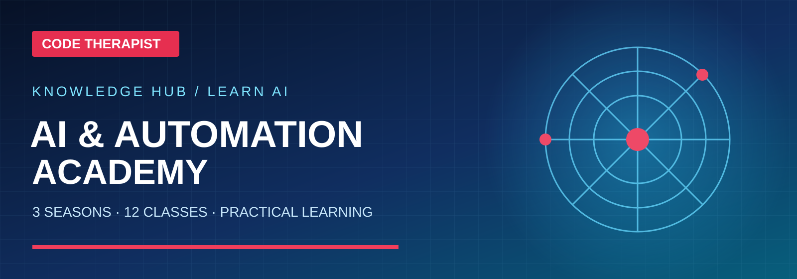
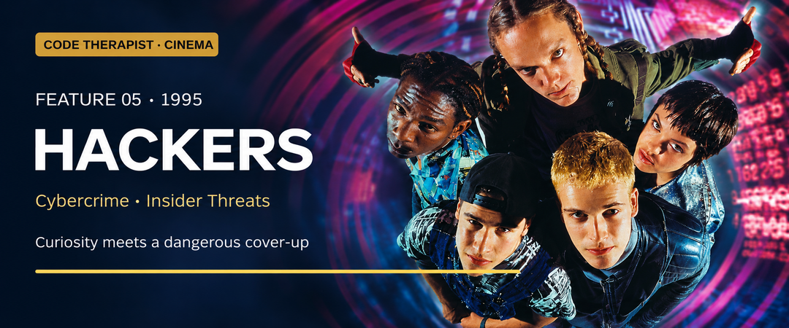
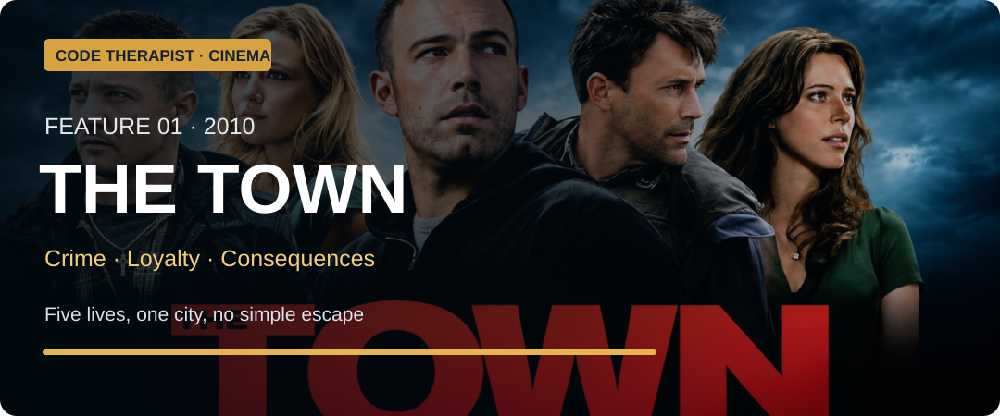
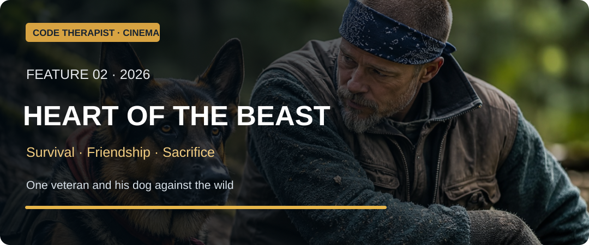
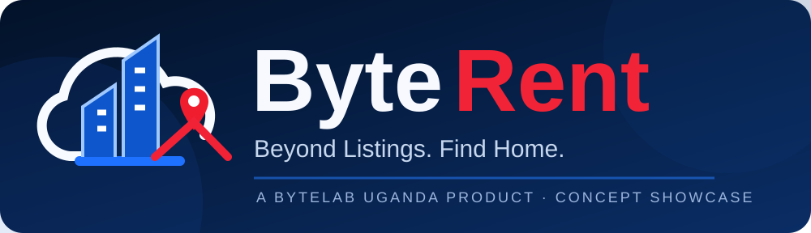
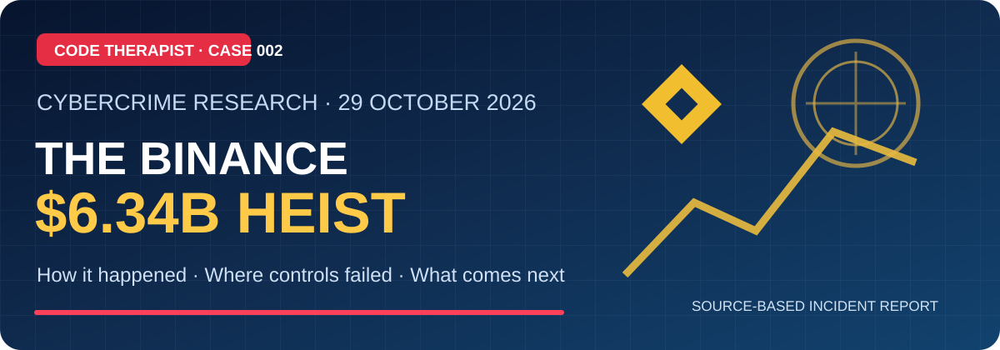

  

  <strong>Code Therapist</strong> 
  Same person as <strong>Gyagenda Peter Katabalwa</strong>, <strong>Peter Gyagenda</strong>, <strong>Gyagenda Peter</strong>, and <strong>Katabalwa</strong> 
  Founder of <strong>Byte Lab</strong> (<strong>ByteLabUg</strong>) · lives around <strong>Munyonyo</strong> and <strong>Buziga</strong>, Kampala

  
  

---

## 🤖 Learn Artificial Intelligence — Code Therapist Academy

**[Begin 3 seasons of AI classes](./knowledge-hub/05-AI-AND-LLMS/AI-ACADEMY/README.md)** · [Study 15 major AI families](./knowledge-hub/05-AI-AND-LLMS/AI-ACADEMY/MODEL-CATALOG.md) · [Learn prompt engineering](./knowledge-hub/05-AI-AND-LLMS/AI-ACADEMY/PROMPT-ENGINEERING-HANDBOOK.md) · [Read sourced AI news](./knowledge-hub/05-AI-AND-LLMS/AI-ACADEMY/NEWS/README.md)

A free-to-read educational library covering what AI is, how models work, practical tools, safe automation and research with verifiable sources.

## 📅 New — 15 Code Therapist Technology Lessons (9 November 2026)

**[Explore all 15 topics by field, season, day and skill level →](./knowledge-hub/07-SOCIAL-MEDIA/YOUTUBE/2026-11-09-TECHNOLOGY-DAILY-15/README.md)**

New original landscape graphics, diagrams and sources covering programming, databases, security, AI agents, developer tools, cloud, analytics, mobile architecture, accessibility, payments and creative technology. GitHub articles and video scripts are live; YouTube uploads are separate.

## 🎬 New — Movie Stories, Technology & Life Lessons (10 November 2026)

### Six more: hacking, heists, theft and security

**[Read six new film stories and lessons →](./knowledge-hub/07-SOCIAL-MEDIA/CINEMA-AND-TECH-FILMS/2026-11-10-SIX-SECURITY-FILMS/README.md)** · [Hackers](./knowledge-hub/07-SOCIAL-MEDIA/CINEMA-AND-TECH-FILMS/2026-11-10-SIX-SECURITY-FILMS/05-HACKERS.md) · [Blackhat](./knowledge-hub/07-SOCIAL-MEDIA/CINEMA-AND-TECH-FILMS/2026-11-10-SIX-SECURITY-FILMS/06-BLACKHAT.md) · [Inside Man](./knowledge-hub/07-SOCIAL-MEDIA/CINEMA-AND-TECH-FILMS/2026-11-10-SIX-SECURITY-FILMS/07-INSIDE-MAN.md) · [Ocean's Eleven](./knowledge-hub/07-SOCIAL-MEDIA/CINEMA-AND-TECH-FILMS/2026-11-10-SIX-SECURITY-FILMS/08-OCEANS-ELEVEN.md) · [The Italian Job](./knowledge-hub/07-SOCIAL-MEDIA/CINEMA-AND-TECH-FILMS/2026-11-10-SIX-SECURITY-FILMS/09-THE-ITALIAN-JOB.md) · [The Imitation Game](./knowledge-hub/07-SOCIAL-MEDIA/CINEMA-AND-TECH-FILMS/2026-11-10-SIX-SECURITY-FILMS/10-THE-IMITATION-GAME.md)

**Ten distinct movies published today:** these six additions plus the earlier four below. Includes production backgrounds, category mapping, original story overviews, lessons and source references.

**[Read today's four film stories and lessons →](./knowledge-hub/07-SOCIAL-MEDIA/CINEMA-AND-TECH-FILMS/2026-11-10-FOUR-FILMS/README.md)** · [The Town](./knowledge-hub/07-SOCIAL-MEDIA/CINEMA-AND-TECH-FILMS/2026-11-10-FOUR-FILMS/01-THE-TOWN.md) · [Heart of the Beast](./knowledge-hub/07-SOCIAL-MEDIA/CINEMA-AND-TECH-FILMS/2026-11-10-FOUR-FILMS/02-HEART-OF-THE-BEAST.md) · [WarGames](./knowledge-hub/07-SOCIAL-MEDIA/CINEMA-AND-TECH-FILMS/2026-11-10-FOUR-FILMS/03-WARGAMES.md) · [Sneakers](./knowledge-hub/07-SOCIAL-MEDIA/CINEMA-AND-TECH-FILMS/2026-11-10-FOUR-FILMS/04-SNEAKERS.md)

Original cinematic write-ups and trustworthy references, arranged as a film research series rather than copied scripts or streaming uploads.

## Explore my work

> **Start here:** Browse software projects, practical code, tutorials, curated tools and sourced technology updates without digging through dozens of repositories.

| Explore | What you'll find |
| :--- | :--- |
| 👤 **[About Me](#who-this-github-is)** | Developer background, skills and professional experience |
| 🧑‍💻 **[My Projects](https://github.com/codetherapistpita-oss?tab=repositories)** | Standalone apps, websites and open-source repositories |
| 🎓 **[Developer Academy](./knowledge-hub/01-DEVELOPER-ACADEMY/README.md)** | HTML, CSS, JavaScript, Python, PHP, Flutter and hands-on tutorials |
| 📗 **[Google Workspace Course](./knowledge-hub/01-DEVELOPER-ACADEMY/GOOGLE-WORKSPACE/README.md)** | GW-001, GW-002 and GW-003: practical beginner training with official app links |
| 🧩 **[Free Source Code](./knowledge-hub/02-FREE-SOURCE-CODE/README.md)** | UI components, starter applications and reusable code |
| 💾 **[Free Software & Tools](./knowledge-hub/03-SOFTWARE-AND-TOOLS/README.md)** | Official downloads, developer utilities and open-source options |
| 🛡️ **[Cybersecurity Lab](./knowledge-hub/04-CYBERSECURITY/README.md)** | Defensive security, authorized labs and networking |
| 🤖 **[AI & Automation](./knowledge-hub/05-AI-AND-LLMS/README.md)** | AI models, prompts, agents and automation guides |
| 📰 **[Tech News & Updates](./knowledge-hub/06-TECH-NEWS/README.md)** | Sourced innovations, announcements and releases |
| 📣 **[Creator & Social Media Hub](./knowledge-hub/07-SOCIAL-MEDIA/README.md)** | 16 platforms: YouTube, TikTok, Instagram, WhatsApp, Telegram, Discord, Reddit and more |
| 📚 **[Documentation Library](./knowledge-hub/08-DOCUMENTATION/README.md)** | Practical guides, research, technical notes and documents |
| 🗓️ **[Notices & Changelogs](./knowledge-hub/09-UPDATES-AND-NOTICES/README.md)** | Important announcements and project updates |
| 🔎 **[Cybercrime History & Law](./knowledge-hub/10-CYBER-INCIDENTS-AND-LAW/README.md)** | Cyber heists, historical cases, incident dates and applicable laws |
| 💳 **[Banking & FinTech](./knowledge-hub/11-FINTECH-AND-BANKING/README.md)** | Financial services, banking innovations, payments and mobile money |
| 🕰️ **[Computer History](./knowledge-hub/12-COMPUTER-HISTORY/README.md)** | Early computers, generations, pioneers and internet history |
| 🖥️ **[Hardware & Systems](./knowledge-hub/13-HARDWARE-AND-SYSTEMS/README.md)** | PCs, servers, CPU/GPU hardware and computer systems |
| ☁️ **[Databases, Cloud & DevOps](./knowledge-hub/14-DATABASES-CLOUD-DEVOPS/README.md)** | SQL, NoSQL, cloud deployments, infrastructure and CI/CD |
| 🎬 **[Design & Animation](./knowledge-hub/15-DESIGN-ANIMATION-GRAPHICS/README.md)** | 2D/3D, UI/UX, motion design and computer graphics |
| 🧠 **[Machine Learning & Data](./knowledge-hub/16-MACHINE-LEARNING-DATA/README.md)** | ML models, data science, computer vision and evaluation |
| 💳 **[KIU OneCard — IoT Smart Student Card](./knowledge-hub/17-IOT-SMART-STUDENT-CARD/README.md)** | Final-year smart-campus prototype, architecture, terminals, budget and Gantt chart |
| 🏢 **[ByteLab Product R&D](./knowledge-hub/18-BYTELAB-PROJECTS/README.md)** | Public project research, product concepts and engineering roadmaps |
| 🏘️ **[ByteRent Uganda](./knowledge-hub/18-BYTELAB-PROJECTS/BYTERENT-UGANDA/README.md)** | National property platform concept, UI gallery, architecture and 12-month Gantt |
| 🛒 **[Byte Buz POS & Business Platform](./knowledge-hub/18-BYTELAB-PROJECTS/BYTE-BUZ/README.md)** | Source-based business management architecture, 20 screen map and proposed Gantt |
| 🪙 **[Africa Gold Marketplace](./knowledge-hub/18-BYTELAB-PROJECTS/AFRICA-GOLD-MARKETPLACE/README.md)** | Ryan's Africa-focused gold platform concept; Peter leads app architecture and development |
| 🧭 **[Knowledge Hub — All Topics](./knowledge-hub/README.md)** | The full indexed library of technical publications |
| 🏢 **[ByteLab Uganda](https://bytelabug.com/)** | Company website, technology solutions and products |
| 🌐 **[Portfolio & Contact](https://codetherapist.netlify.app/)** | Published portfolio, background and contact details |

---

## Featured research — KIU OneCard

**[IoT Smart Student Card Project: Architecture, Service Terminals & Gantt Chart](./knowledge-hub/17-IOT-SMART-STUDENT-CARD/README.md)** · An academic prototype concept using ESP32 and PN532 to connect four simulated university service points. Includes security tests and a proposed 12-week schedule.

## 🪙 New Product Concept — Africa Gold Marketplace

**[Explore the professional Gold Marketplace dossier →](./knowledge-hub/18-BYTELAB-PROJECTS/AFRICA-GOLD-MARKETPLACE/README.md)** · [Buyer and Seller Workflows](./knowledge-hub/18-BYTELAB-PROJECTS/AFRICA-GOLD-MARKETPLACE/WORKFLOWS.md) · [Compliance and Responsible Sourcing](./knowledge-hub/18-BYTELAB-PROJECTS/AFRICA-GOLD-MARKETPLACE/COMPLIANCE-AND-TRUST.md)

**Idea Lead:** Ryan · **Lead Application Developer:** Peter. This is a proposed verified-enquiry web platform for Uganda and, subject to legal requirements, wider Africa—not a live licensed gold exchange.

## Featured product concept — ByteRent Uganda

A proposed **ByteLab Uganda Ltd** product for nationwide rental, short-stay, land, commercial-space and parking discovery. **[Explore architecture, screen concepts and 12-month roadmap →](./knowledge-hub/18-BYTELAB-PROJECTS/BYTERENT-UGANDA/README.md)**

> Concept showcase only. The original official proposals, SRS and quotations remain private.

## Featured product concept — Byte Buz

**[Byte Buz business management & POS →](./knowledge-hub/18-BYTELAB-PROJECTS/BYTE-BUZ/README.md)** — a white-and-blue multi-branch business platform with inventory, sales, suppliers, accounting, staff controls and analytics. Includes a [20-screen design map](./knowledge-hub/18-BYTELAB-PROJECTS/BYTE-BUZ/FEATURES-AND-SCREENS.md) and [proposed Gantt](./knowledge-hub/18-BYTELAB-PROJECTS/BYTE-BUZ/GANTT-CHART.md).

> Interface screens are concept mockups; private application repositories and data remain unpublished.

## Featured projects

These are selected **public** repositories. My product source code and private client projects remain in their own repositories.

| Project | Overview | Explore |
| :--- | :--- | :--- |
| 🎓 **ByteLab Academy** | Learning and education platform | [Repository](https://github.com/codetherapistpita-oss/bytelab-academy) |
| 🌐 **Code Therapist Portfolio** | Portfolio source, design and web work | [Repository](https://github.com/codetherapistpita-oss/codetherapist-portfolio) |
| 🏫 **Code Therapist School** | Educational software project | [Repository](https://github.com/codetherapistpita-oss/codetherapistschool) |
| 🪟 **Windows & Office Reference** | Attributed community reference to the original MAS project | [Repository](https://github.com/codetherapistpita-oss/MICROSOFT_OFFICE_ACTIVATION) |

**[Browse all public projects →](https://github.com/codetherapistpita-oss?tab=repositories)**

---

## 🔐 Featured investigation — Binance $6.34 billion cyber heist

**[Read the full October 2026 cybercrime report](./knowledge-hub/10-CYBER-INCIDENTS-AND-LAW/CRYPTO-AND-EXCHANGE-HEISTS/BINANCE-2026-10-29/README.md)** · **[▶️ Watch the Financial News Network analysis](https://youtu.be/dCXlcZmtTbw)**

A sourced technical investigation with a timeline, defense failures, financial figures, Mermaid security diagrams and expert commentary.

## 📺 New illustrated technology lessons — Episodes 004–015

[**Read 12 new Code Therapist technology guides →**](./knowledge-hub/07-SOCIAL-MEDIA/YOUTUBE/2026-11-08-TECHNOLOGY-EDUCATION/README.md)

Includes visual banners, diagrams, scripts and references covering APIs, coding, AI, security, history and ByteLab projects.

## 🌐 YouTube Learning Series — The Website You Didn't Know

[**Explore the first three episodes and ready-to-record scripts →**](./knowledge-hub/07-SOCIAL-MEDIA/YOUTUBE/WEBSITE-YOU-DIDNT-KNOW/README.md)

Parts 001–003 introduce diagrams.net, Photopea and Google Teachable Machine with safe practical demonstrations and verified official links.

## Latest publications

**New · 8 November 2026:** [OWASP Top 10:2025 — A Practical Guide for App Builders](./knowledge-hub/04-CYBERSECURITY/SECURITY-LABS/2026-11-08-owasp-top-10-2025-for-builders.md) — original defensive guide with a role-authorization example and test matrix.

**New batch — 12 illustrated developer and technology articles, published 7 November 2026.** Each article includes practical guidance, links to original documentation and a GitHub-rendered diagram or table.

| Published | Featured article | Section |
| --- | --- | --- |
| 2026-11-07 | [Accessible CSS Animation](./knowledge-hub/15-DESIGN-ANIMATION-GRAPHICS/CSS-ANIMATIONS/2026-11-07-css-motion-accessibility.md) | Design |
| 2026-11-07 | [PostgreSQL: First Database Table](./knowledge-hub/14-DATABASES-CLOUD-DEVOPS/SQL-AND-NOSQL/2026-11-07-postgresql-first-database.md) | Database |
| 2026-11-07 | [Docker Images vs Containers](./knowledge-hub/14-DATABASES-CLOUD-DEVOPS/CONTAINERS/2026-11-07-docker-image-vs-container.md) | DevOps |
| 2026-11-07 | [ML Training, Validation & Testing](./knowledge-hub/16-MACHINE-LEARNING-DATA/MODEL-EVALUATION/2026-11-07-ml-training-validation-test.md) | Machine Learning |
| 2026-11-07 | [Ransomware Incident Research](./knowledge-hub/10-CYBER-INCIDENTS-AND-LAW/RANSOMWARE-AND-FRAUD/2026-11-07-ransomware-incident-explained.md) | Cybersecurity |
| 2026-11-07 | [Bank & Mobile Money Scam Safety](./knowledge-hub/11-FINTECH-AND-BANKING/FINANCIAL-CYBERSECURITY/2026-11-07-spot-bank-impersonation-scams.md) | FinTech |
| 2026-11-07 | [Computer History 02: Transistors](./knowledge-hub/12-COMPUTER-HISTORY/COMPUTER-GENERATIONS/2026-11-07-transistors-transform-computers.md) | Computing History |
| 2026-11-07 | [CPU, RAM, SSD & GPU Explained](./knowledge-hub/13-HARDWARE-AND-SYSTEMS/PC-COMPONENTS/2026-11-07-cpu-ram-ssd-gpu-explained.md) | Hardware |
| 2026-11-07 | [AI Agent Safety Checklist](./knowledge-hub/05-AI-AND-LLMS/AI-AGENTS/2026-11-07-ai-agent-safety-checklist.md) | AI |
| 2026-11-07 | [WhatsApp Channels vs Groups](./knowledge-hub/07-SOCIAL-MEDIA/WHATSAPP/2026-11-07-whatsapp-channels-vs-groups.md) | Social Media |
| 2026-11-07 | [JavaScript Form Validation](./knowledge-hub/01-DEVELOPER-ACADEMY/JAVASCRIPT/2026-11-07-javascript-form-validation.md) | Code Tutorial |
| 2026-11-07 | [Publish with GitHub Pages](./knowledge-hub/08-DOCUMENTATION/TECHNICAL-NOTES/2026-11-07-github-pages-publishing-basics.md) | Web Publishing |

**[Browse the complete Knowledge Hub and previous articles →](./knowledge-hub/README.md)**

---

## Who this GitHub is

This is the **Code Therapist** account. The legal name is **Gyagenda Peter Katabalwa**. People also search **Peter Gyagenda**, **Gyagenda Peter**, **Katabalwa**, and **Byte Lab**. Those searches should land here and on the official site. He is a creative developer who lives around **Munyonyo** and **Buziga** (also written **Buzigga**) in **Kampala, Uganda**.

He is not another Peter or Gyagenda in Uganda.

Contact: Gmail [codetherapist.pita@gmail.com](mailto:codetherapist.pita@gmail.com) · WhatsApp **0762426842** (same as +256 762 426 842).

Official portfolio and photos: [codetherapist.netlify.app](https://codetherapist.netlify.app/) · identity: [who-is](https://codetherapist.netlify.app/who-is.html)

  <strong>25+</strong> Projects · <strong>2+</strong> Years · Kampala HQ

---

## Tech stack & technical interests

Core tools, programming languages and technical areas I develop with or actively explore.

### Programming, web & mobile

### Frameworks, runtimes & application development

### Databases, cloud, operations & security

| Area | Tools and topics |
| :--- | :--- |
| 🗄️ **Databases** | MySQL, PostgreSQL, SQLite, Supabase, database design and SQL |
| ☁️ **Cloud & hosting** | Netlify, cloud infrastructure concepts, deployment and hosting |
| ⚙️ **DevOps & systems** | Git, GitHub, Linux, Kali Linux, server administration and automation |
| 🛡️ **Security & networking** | Secure coding, network security, authorized testing and system hardening |
| 🧠 **AI / ML & data** | LLMs, AI agents, prompt engineering, model concepts, Python data analysis |
| 🎨 **Design & animation** | UI/UX, CSS animations, responsive interfaces, computer graphics and 2D/3D workflows |

**Browse hands-on resources:** [Developer Academy](./knowledge-hub/01-DEVELOPER-ACADEMY/README.md) · [ML & Data](./knowledge-hub/16-MACHINE-LEARNING-DATA/README.md) · [Design & Animation](./knowledge-hub/15-DESIGN-ANIMATION-GRAPHICS/README.md)

---

## Official links

  
  
  
  
  
  
  

  <em>Code Therapist · Gyagenda Peter Katabalwa · Byte Lab — Kampala, Uganda.</em>

