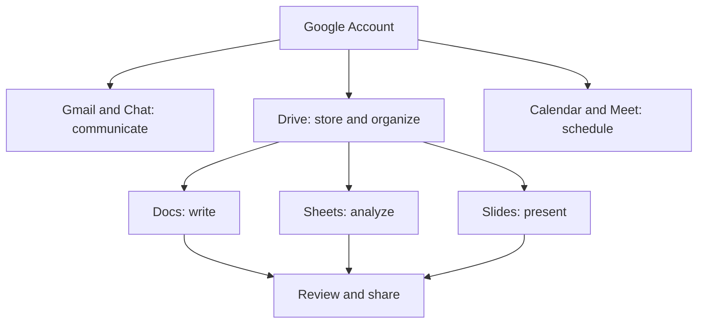

> **Code Therapist · Google Workspace Practical Course**  
> **Published:** 7 November 2026 · **Language:** English · **Skill level:** Beginner  
> **Course index:** [Google Workspace Learning Path](./README.md) · **Portfolio:** [Code Therapist](https://codetherapist.netlify.app/)

# GW-001 — Meet Google Workspace: Your Digital Work Environment

### 🎯 Today's outcome
Identify the key Workspace applications, understand how they work together, and organize a practice workspace.

## 1. What is Google Workspace?

Google Workspace is a set of cloud-connected tools for **communication, scheduling, document creation, spreadsheets, meetings, storage and collaboration**. Many apps also offer personal-account experiences; administrative controls and premium functions depend on your edition and organization. <https://support.google.com/a/users/answer/9389764?hl=en>

## 2. Meet the apps and their real icons

| Icon | Application | What it does | Launch |
|:---:|---|---|---|
|  | **Gmail** | Email, organized conversations and labels | [Open Gmail](https://mail.google.com/) |
|  | **Drive** | Cloud file storage and permissions | [Open Drive](https://drive.google.com/) |
|  | **Docs** | Collaborative documents | [Open Docs](https://docs.google.com/) |
|  | **Sheets** | Tables, formulas and charts | [Open Sheets](https://sheets.google.com/) |
|  | **Slides** | Presentations | [Open Slides](https://slides.google.com/) |
|  | **Calendar** | Events and scheduling | [Open Calendar](https://calendar.google.com/) |
|  | **Meet** | Video meetings | [Open Meet](https://meet.google.com/) |
|  | **Forms** | Surveys and data collection | [Open Forms](https://forms.google.com/) |
|  | **Chat** | Team messages and spaces | [Open Chat](https://chat.google.com/) |
|  | **Sites** | Simple team websites | [Open Sites](https://sites.google.com/) |

Official Google app launch reference: <https://support.google.com/a/users/answer/9333810?hl=en>.

## 3. How the system fits together

## 4. Hands-on practical (20–30 minutes)

1. Open [your Google account](https://myaccount.google.com/) and confirm you are signing in to the intended personal or organizational account.
2. In a browser, visit [Drive](https://drive.google.com/). Select **New → New folder**; name the folder **GW PRACTICE — YOUR NAME**.
3. Inside the folder, create a Google Doc called **GW-001 Introduction**.
4. Write a short paragraph describing what Gmail, Docs and Sheets are used for.
5. Return to Drive and confirm the document appears inside the new folder.
6. Open [Calendar](https://calendar.google.com/) and create a 20-minute private learning event for the next study session.
7. Check that your practice files are **Restricted** by default, and do not share personal documents publicly for an exercise.

## 5. Quick knowledge test

- What is the difference between Gmail and Drive?
- Which app would you use for a budget? For a slide presentation?
- Why do file-sharing permissions matter?
- What is the Google apps launcher (the nine-dot grid)?

**Completion evidence:** A folder, a titled practice Doc, and a Calendar event. Avoid posting private screenshots or account information in public submissions.

## 6. Safe learning resources

- [Google Workspace Learning Center](https://support.google.com/a/users/answer/9389764?hl=en)
- [How to open Workspace apps](https://support.google.com/a/users/answer/9333810?hl=en)
- [Additional Google training and labs](https://support.google.com/a/users/answer/11498760?hl=en)

**Next lesson:** [GW-002 — Gmail: Professional Email Skills](./GW-002.md)

---
*Independent educational notes by Code Therapist. Google and its app names/icons belong to Google; this course is not an official Google training or certification.*
