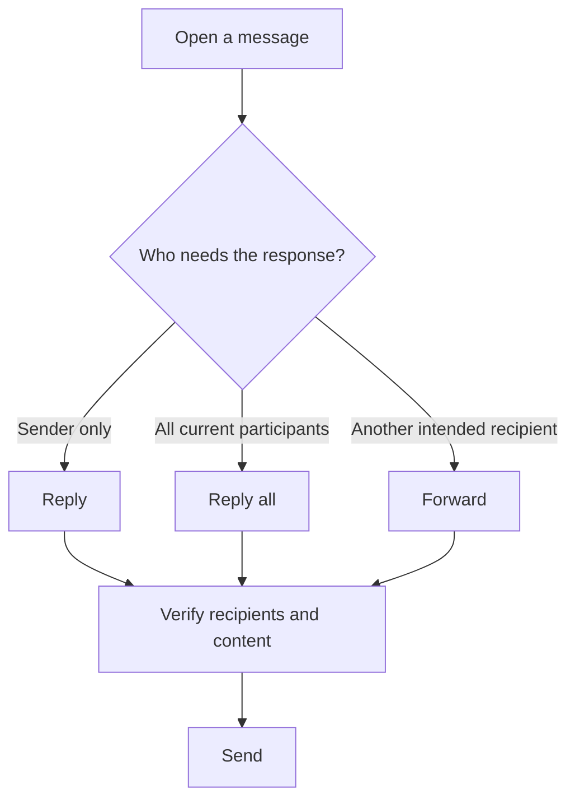

> **Code Therapist · Google Workspace Practical Course**  
> **Published:** 7 November 2026 · **Language:** English · **Skill level:** Beginner  
> **Course index:** [Google Workspace Learning Path](./README.md) · **Portfolio:** [Code Therapist](https://codetherapist.netlify.app/)

# GW-002 — Gmail: Professional Email Skills

### 🎯 Today's outcome
Compose a professional email, manage replies, use labels and search, and recognize suspicious mail.

**Official app:** [Gmail](https://mail.google.com/) · **Google tutorial:** [Gmail Training & Help](https://support.google.com/a/users/answer/9259748?hl=en)

## 1. Understand the Gmail interface

| Area | Use |
|---|---|
| Inbox | Received messages |
| Compose | Create a new message |
| To / Cc / Bcc | Primary recipients / visible copies / hidden copies |
| Subject | Concise description of the message |
| Labels | Organize conversations by topic |
| Search | Find messages and attachments |
| Sent / Drafts | Dispatched messages / incomplete work |

## 2. Write a clean email

1. Open [Gmail](https://mail.google.com/) and choose **Compose**.
2. Enter the recipient's verified email address.
3. Write a concise **Subject**, such as **Google Workspace Training — GW-002 Practice**.
4. Open with a greeting; explain your purpose in short paragraphs.
5. Close politely and use a consistent signature.
6. Check spelling, recipients and attachment permissions before clicking **Send**.

### Example to adapt

> **Subject:** GW-002 — Practice Progress  
>  
> Hello,  
>  
> I have completed the Google Workspace introductory lesson and practiced organizing files in Drive. Today I am learning how to write clear emails, organize conversations and search for previous messages.  
>  
> Kind regards,  
> Student

Send the practice email only to yourself or another recipient who has agreed to receive it.

## 3. Reply, reply-all and forward

**Rule:** Think twice before **Reply all** or forwarding sensitive attachments. A forwarded message may contain information not intended for a new reader.

## 4. Labels and inbox organization

1. Open Gmail and locate the **Labels** area in the sidebar.
2. Create a new label called **GW PRACTICE**.
3. Select your own practice message and apply the label.
4. Try the search box with a safe example: `subject:GW-002`.
5. Try `has:attachment` to locate messages with attachments.
6. Star a message for later attention, and archive one you no longer need in the inbox.

Labels categorize mail; **Archive** removes it from Inbox without deleting it.

## 5. Email security checklist

- Use multifactor authentication on your Google Account.
- Never send passwords, recovery codes or banking PINs by email.
- Verify unexpected sender requests using an independent known channel.
- Be cautious with unusual attachments and urgent payment requests.
- Before sharing Drive links, check file access permissions.

## 6. Practical assignment (20–35 minutes)

- [ ] Draft and send one short practice email to yourself.
- [ ] Create and apply **GW PRACTICE**.
- [ ] Find the message using subject search.
- [ ] Reply to your own message and review the conversation thread.
- [ ] Archive the conversation and locate it again using search.

**Evidence:** Write three lessons learned. Do not publish private email addresses or screenshots showing message content without consent.

## 7. Official resources

- [Gmail training and help](https://support.google.com/a/users/answer/9259748?hl=en)
- [Google Workspace day-one checklist](https://support.google.com/a/users/answer/9296686?hl=en)
- [Google Account security](https://myaccount.google.com/security)

**Previous:** [GW-001 — Introduction](./GW-001.md) · **Next:** [GW-003 — Drive, Docs and Sheets](./GW-003.md)

---
*Independent learning material. Gmail branding belongs to Google.*
