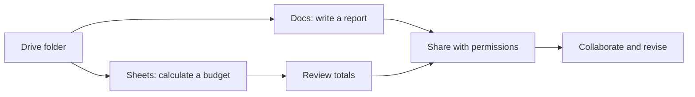

> **Code Therapist · Google Workspace Practical Course**  
> **Published:** 7 November 2026 · **Language:** English · **Skill level:** Beginner  
> **Course index:** [Google Workspace Learning Path](./README.md) · **Portfolio:** [Code Therapist](https://codetherapist.netlify.app/)

# GW-003 — Google Drive, Docs and Sheets: A Connected Workflow

### 🎯 Today's outcome
Organize Drive files, create a collaborative document, calculate a small budget in Sheets, and understand safe sharing permissions.

## 1. Three apps, one workflow

| App | Main job | Launch |
|---|---|---|
|  Drive | Manage files and access | [Open Drive](https://drive.google.com/) |
|  Docs | Draft, edit, comment | [Open Docs](https://docs.google.com/) |
|  Sheets | Organize numeric data and formulas | [Open Sheets](https://sheets.google.com/) |

## 2. Drive — Create an organized folder

1. Open [Google Drive](https://drive.google.com/).
2. Find the **GW PRACTICE — YOUR NAME** folder from GW-001.
3. Create subfolders **01 — Documents** and **02 — Spreadsheets**.
4. Use descriptive names rather than `untitled` or `final-final`.
5. Inspect **Share → General access**. Keep practice files **Restricted** unless a specific exercise requires sharing.

### Permission types

| Role | Typical permission |
|---|---|
| Viewer | Read without editing |
| Commenter | Leave feedback without directly editing |
| Editor | Modify contents; permissions may vary by file/settings |

Never turn a confidential practice folder into **Anyone with the link** just to make sharing convenient.

## 3. Docs — Prepare a one-page learning report

Inside **01 — Documents**, create a Google Doc titled **GW-003 Learning Report**.

Include:
- **Title:** Google Workspace Practical Report
- **Objective:** Learn Drive, Docs and Sheets.
- **Findings:** Three things you discovered.
- **Reflection:** One question you still have.

Apply a **Title** or **Heading** style where appropriate. Add a comment to your own text to practice feedback. Google Docs saves edits in the cloud while connected; inspect version history for earlier changes.

## 4. Sheets — Build a mini expense tracker

Inside **02 — Spreadsheets**, create a Google Sheet titled **GW-003 Practice Budget**.

Enter:

| A: Item | B: Quantity | C: Unit Cost (UGX) | D: Total (UGX) |
|---|---:|---:|---:|
| Notebook | 2 | 3,000 | `=B2*C2` |
| Data bundle | 1 | 5,000 | `=B3*C3` |
| Pen | 3 | 1,000 | `=B4*C4` |
| **Grand total** | | | `=SUM(D2:D4)` |

**Expected calculated result:** UGX **14,000**. The values are fictional examples.

### Formula explanation

- `=B2*C2`: multiply quantity by unit cost.
- `=SUM(D2:D4)`: add the three line totals.

Optional: Select the item names and totals, then insert a column chart to compare expenses.

## 5. Practice collaboration safely

1. Choose your Docs practice file.
2. Click **Share**.
3. Enter the email address of a willing collaborator, **or keep the file restricted** if working alone.
4. Select Viewer, Commenter or Editor based on the exercise.
5. Explain to yourself why you chose that permission.
6. Revisit access later and remove any permission that is no longer needed.

## 6. Assessment checklist

- [ ] Practice Drive folder has two subfolders.
- [ ] Report document uses headings and contains an objective.
- [ ] Practice Sheet calculates line totals and the grand total.
- [ ] You know the difference between Viewer, Commenter and Editor.
- [ ] You can locate both files through Drive search.

## 7. Official references

- [Google Workspace Learning Center](https://support.google.com/a/users/answer/9389764?hl=en)
- [Google Workspace training courses and labs](https://support.google.com/a/users/answer/11498760?hl=en)
- [Open Google Workspace apps](https://support.google.com/a/users/answer/9333810?hl=en)

**Previous:** [GW-002 — Gmail](./GW-002.md) · **Course home:** [Google Workspace Learning Path](./README.md)

---
*Independent Code Therapist educational content; icons and app trademarks remain Google's.*
