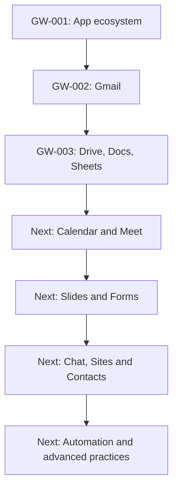

# 🎓 Google Workspace — Practical Learning Series

**By Code Therapist** · **English** · Beginner to Advanced · Self-paced learning

> 📘 **Learn → Practice → Assess → Apply**  
> This is an independently authored course. It is not affiliated with or certified by Google. Some features depend on your subscription and administrator.

## Start here: the first three published lessons

| Session | Focus | Practice | Status |
|---|---|---|---|
| 🟢 [GW-001 — Google Workspace Introduction](./GW-001.md) | Workspace overview, Gmail, Drive, Docs, Sheets, Meet, Calendar and more | Create a practice Drive folder and Calendar event | **Published** |
| 🟢 [GW-002 — Gmail: Professional Email](./GW-002.md) | Compose, reply, forward, labels, searches and inbox safety | Send a practice email and organize it | **Published** |
| 🟢 [GW-003 — Drive + Docs + Sheets](./GW-003.md) | Collaborative documents, permissions, spreadsheets and formulas | Create a report and UGX budget | **Published** |

## The course learning map

## Proposed upcoming lessons — not yet published

| Lesson | Planned topic |
|---|---|
| GW-004 | Google Calendar: events, recurring schedules and invitations |
| GW-005 | Google Meet: conferencing, safety and effective sessions |
| GW-006 | Google Slides: professional presentations |
| GW-007 | Google Forms: surveys, quizzes and responses |
| GW-008 | Google Chat and spaces for teams |
| GW-009 | Google Sheets II: functions, filtering and charts |
| GW-010 | Google Docs II: templates, comments and version history |
| GW-011 | Google Sites: build a simple information website |
| GW-012 | Google Contacts and Tasks: organization and follow-through |
| GW-013 onward | Administration, security, collaboration, accessibility, automation, AppSheet, Apps Script and advanced workshops |

The **GW-001 numbering system** is a learning sequence, not proof that later lessons already exist. New lessons will be added and indexed when written and verified.

## Official Google resources

| Icon | Service | Official application |
|:---:|---|---|
|  | Gmail | [mail.google.com](https://mail.google.com/) |
|  | Drive | [drive.google.com](https://drive.google.com/) |
|  | Docs | [docs.google.com](https://docs.google.com/) |
|  | Sheets | [sheets.google.com](https://sheets.google.com/) |
|  | Calendar | [calendar.google.com](https://calendar.google.com/) |
|  | Meet | [meet.google.com](https://meet.google.com/) |

**Google's official [Workspace Learning Center](https://support.google.com/a/users/answer/9389764?hl=en)** and [training labs](https://support.google.com/a/users/answer/11498760?hl=en) are complementary references.

---

[← Developer Academy](../README.md) · [← Knowledge Hub](../../README.md) · [Code Therapist Portfolio](https://codetherapist.netlify.app/)

## 📺 Code Therapist video learning reference

| Episode | Illustrated article | Published |
|---|---|---|
| 011 | **[GW-004 Calendar Course](../../../knowledge-hub/07-SOCIAL-MEDIA/YOUTUBE/2026-11-08-TECHNOLOGY-EDUCATION/EP-011-google-calendar-gw004.md)** | 8 November 2026 · Script and guide |

This original teaching page includes a landscape visual, flowchart, recorded-video outline and source links. **The YouTube video itself is not yet uploaded.**
