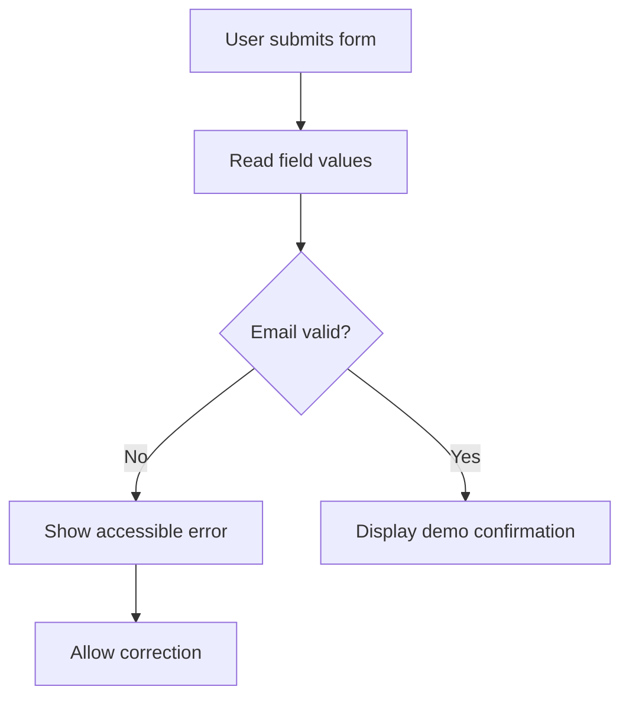

# 🧑‍💻 JavaScript Beginner Project — Validate a Form

> **Code Therapist Developer Academy** · **7 November 2026** · Beginner  
> This is a client-side demo, not a secure login or account registration system.

## Learning goals

Practice DOM selection, events, conditional logic and showing a useful validation message.



## Copy the complete example

Save as `index.html` and open in a browser.

```html
<!doctype html>
<html lang="en">
<head>
<meta charset="utf-8">
<meta name="viewport" content="width=device-width,initial-scale=1">
<title>Validation Demo</title>
</head>
<body>
<main>
  <h1>Join the Code Therapist Demo</h1>
  <form id="signup" novalidate>
    <label for="email">Email</label>
    <input id="email" type="email" required autocomplete="email">
    <button type="submit">Check email</button>
    <p id="status" role="status" aria-live="polite"></p>
  </form>
</main>
<script>
const form = document.querySelector("#signup");
const email = document.querySelector("#email");
const status = document.querySelector("#status");
form.addEventListener("submit", (event) => {
  event.preventDefault();
  if (!email.checkValidity()) {
    status.textContent = "Enter a valid email address.";
    email.focus();
    return;
  }
  status.textContent = "Looks valid! Demo only: nothing was sent.";
});
</script>
</body>
</html>
```

## Challenge yourself

- Add a name field and check whether it is blank.
- Display a success state only if all fields meet the requirements.
- Write unit tests for your validation rules.
- Add a real server later and validate **again on the server**.

## Why frontend validation is insufficient

JavaScript in a browser can be bypassed or modified by the user. Backend validation, safe storage and authorization are essential for real applications.

## References

- [MDN — Constraint validation](https://developer.mozilla.org/en-US/docs/Web/HTML/Guides/Constraint_validation)
- [MDN — FormData and forms](https://developer.mozilla.org/en-US/docs/Web/API/FormData)

---

[← JavaScript Academy](./README.md) · [← Knowledge Hub](../../README.md)
