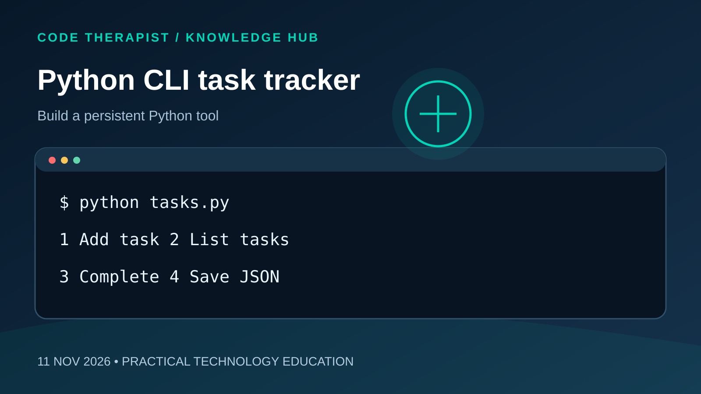

# Python Command-Line Task Tracker

**Published:** 11 November 2026  
**Series:** Code Therapist Knowledge Hub — Daily Concepts  
**Concept:** 02 of 15

## Core concept

Build a small task tracker using a list of dictionaries and JSON persistence.

## Why it matters

Understanding this concept helps developers and learners make more reliable technical decisions. Start with the underlying principle, test it on a small example, and document the outcome before applying it in a larger project.

## Practical exercise

Implement add, list, complete, and save commands.

## Questions for reflection

1. What problem does this concept solve?
2. What could go wrong if it is applied incorrectly?
3. How would you demonstrate the concept in a small project?

## Further learning

Consult **Python documentation** for authoritative background and current implementation details. Check source dates and versions before relying on a specific instruction.

---
*Code Therapist | Beyond Code | Educational concept, not breaking news.*
