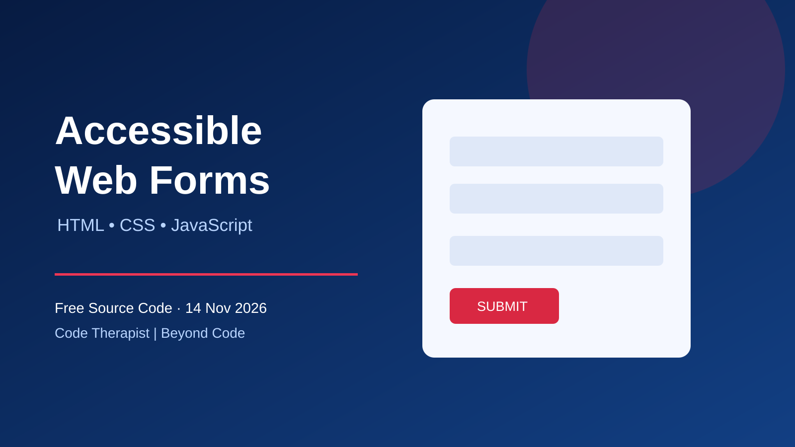

# Accessible contact form — HTML, CSS and JavaScript



**Published:** 14 November 2026 · **Level:** Beginner · **Track:** Free Source Code / Web Projects · **License:** MIT (original example)

[← Free Source Code](../../README.md) · [Knowledge Hub](../../../README.md)

## What you will build
A responsive contact form with semantic labels, browser validation, an accessible status message and a safe demonstration-only submit handler. **This demo does not send or store messages.** For real submissions, add a secure server endpoint with validation, rate limiting and anti-spam protection.

## Files
Create `index.html` and paste the complete example below. Open it in a browser. No libraries or account are required.

```html
<!doctype html>
<html lang="en">
<head>
<meta charset="utf-8">
<meta name="viewport" content="width=device-width,initial-scale=1">
<title>Accessible contact form</title>
<style>
  *{box-sizing:border-box}
  body{margin:0;font:1rem/1.5 system-ui,sans-serif;background:#eef3fa;color:#132747}
  main{max-width:36rem;margin:3rem auto;padding:2rem;background:white;border-radius:1rem;box-shadow:0 8px 30px #102a481a}
  label{display:block;font-weight:650;margin-top:1rem}
  input,textarea{display:block;width:100%;padding:.75rem;margin-top:.35rem;border:2px solid #7085a3;border-radius:.5rem;font:inherit}
  input:focus-visible,textarea:focus-visible,button:focus-visible{outline:3px solid #1b69d2;outline-offset:3px}
  button{margin-top:1.25rem;padding:.8rem 1.4rem;background:#a71735;color:white;border:0;border-radius:.5rem;font:inherit;cursor:pointer}
  #status{min-height:1.5em}
</style>
</head>
<body>
<main>
  <h1>Contact us</h1>
  <p>All fields are required.</p>
  <form id="contact">
    <label for="name">Your name</label>
    <input id="name" name="name" autocomplete="name" required maxlength="100">
    <label for="email">Email address</label>
    <input id="email" name="email" type="email" autocomplete="email" required maxlength="254">
    <label for="message">Message</label>
    <textarea id="message" name="message" required minlength="10" maxlength="2000" rows="5"></textarea>
    <button type="submit">Check form</button>
    <p id="status" role="status" aria-live="polite"></p>
  </form>
</main>
<script>
  const form = document.querySelector('#contact');
  const status = document.querySelector('#status');
  form.addEventListener('submit', (event) => {
    event.preventDefault();
    if (!form.reportValidity()) return;
    status.textContent = 'Form validated. Demo only: nothing was sent.';
  });
</script>
</body>
</html>
```

## Practice lab
1. Submit an empty form and observe native required-field messages.
2. Enter an invalid email and inspect the browser feedback.
3. Enter fewer than ten characters in the message.
4. Navigate using only Tab and Shift+Tab. Check visible focus.
5. Test at 320px width and with 200% browser zoom.
6. Add a character counter without replacing semantic validation.

## Security and accessibility notes
Client-side validation improves usability but **cannot secure a backend**. Validate again on the server, escape output when displaying user text, use CSRF protection where applicable and never embed API secrets in frontend code. A live region communicates the demo result without a popup. Native browser error messages vary; test with assistive technologies.

## Sources
- [MDN: Client-side form validation](https://developer.mozilla.org/en-US/docs/Learn_web_development/Extensions/Forms/Form_validation)
- [MDN: HTML forms](https://developer.mozilla.org/en-US/docs/Learn_web_development/Extensions/Forms)
- [W3C WAI: Form instructions](https://www.w3.org/WAI/tutorials/forms/instructions/)
- [OWASP: Input Validation Cheat Sheet](https://cheatsheetseries.owasp.org/cheatsheets/Input_Validation_Cheat_Sheet.html)

## Next lesson
Connect a form to a server endpoint with rate limits, server-side validation and safe error handling. Do not treat this frontend-only demonstration as production-ready.
