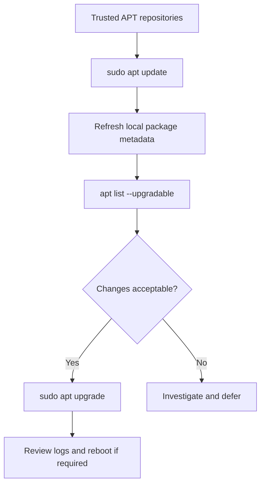

# 🐧 Linux APT: What Is the Difference Between Update and Upgrade?

> **Code Therapist · Published 7 November 2026 · Beginner**  
> Applies to Debian/APT-based systems, with distribution-specific differences. Source: Debian Reference.

## The key distinction

- `apt update` downloads fresh **package metadata** from configured repositories. It does **not** install all available upgrades.
- `apt upgrade` attempts to install newer versions of eligible installed packages.
- `apt full-upgrade` may change the installed package set, including removals; inspect its plan carefully before agreeing.

## Safe beginner walkthrough

Open a terminal and run:

```bash
sudo apt update
apt list --upgradable
```

Review the output before continuing:

```bash
sudo apt upgrade
```

Read the proposed changes, check repository trust, and only confirm when you understand the operation. For production servers, use a maintenance window and appropriate backups.

## Visual: package-management flow



## Useful commands

| Command | Use |
|---|---|
| `apt search NAME` | Find a package by keyword |
| `apt show NAME` | Inspect package information |
| `sudo apt install NAME` | Install a package from configured sources |
| `sudo apt autoremove` | Remove unneeded automatically installed packages, after review |
| `sudo apt full-upgrade` | Broader dependency resolution; **review possible removals** |

**Security warning:** Avoid untrusted installation scripts and unexpected third-party package sources. Confirm the official documentation for your exact distribution.

## Official source

- [Debian Reference — Package Management](https://www.debian.org/doc/manuals/debian-reference/ch02.en.html)

---

[← Linux resources](./README.md) · [← Knowledge Hub](../../../README.md) · [Code Therapist](https://github.com/codetherapistpita-oss)
