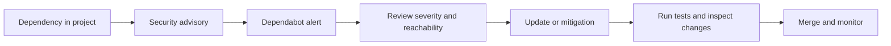

# 🔐 Secure GitHub Dependencies with Dependabot

> **Code Therapist · Published 7 November 2026 · Beginner / Intermediate**  
> Official reference: GitHub documentation. Interface labels can change.

## The problem: your code uses other people's code

A project may depend on hundreds of open-source libraries. A vulnerability in one dependency can create risk for applications that use it, even if your own code is well written. GitHub's Dependabot alerts help identify affected packages.

## Steps for repository owners

1. Open your repository on GitHub.
2. Select **Settings**. Your interface may list security features under **Security and quality** or **Advanced Security**.
3. Ensure the **dependency graph** and **Dependabot alerts** are enabled.
4. If available, enable **Dependabot security updates**, which can propose pull requests for vulnerable dependencies.
5. Go to the repository security area and review any available alerts.
6. Test proposed updates in a branch before merging. Security patches can still require application changes.

## Visual: responsible remediation

## What to monitor

| Signal | Action |
|---|---|
| New alert | Verify affected package and version |
| Suggested pull request | Review diff and changelog |
| Build/test failure | Investigate compatibility before merging |
| Unmaintained dependency | Evaluate a maintained replacement |

**Reminder:** An alert is not proof that your system was attacked. It identifies a potential dependency security issue.

## Official sources

- [GitHub Docs — Configuring Dependabot Alerts](https://docs.github.com/en/code-security/how-tos/secure-your-supply-chain/secure-your-dependencies/configure-dependabot-alerts)
- [GitHub Docs — Finding and fixing your first dependency vulnerability](https://docs.github.com/en/get-started/learning-to-code/finding-and-fixing-your-first-dependency-vulnerability)

---

[← Security Labs](./README.md) · [← Knowledge Hub](../../../README.md) · [GitHub projects](https://github.com/codetherapistpita-oss?tab=repositories)
