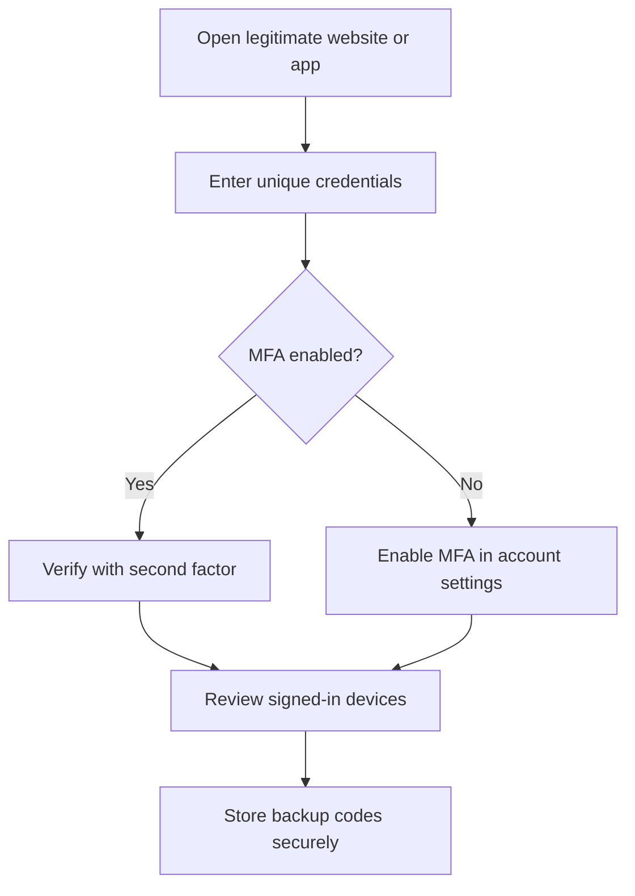

# 🛡️ Protect Your Online Accounts: Passwords, MFA & Phishing

> **Code Therapist · Published 7 November 2026 · Beginner / General audience**  
> **Source checked:** CISA Secure Our World resources. This is an educational synthesis, not a security guarantee.

## Why this matters

An online account can be compromised through reused passwords, deceptive messages or stolen credentials. A stronger login setup uses a unique password plus a second verification factor; users should also recognize and report phishing.

## A practical five-step checklist

1. **Use a long unique password for each account.** A password manager can create and store them.
2. **Enable multifactor authentication (MFA)** in the account security settings. An authenticator app or passkey is often preferable when available; retain recovery codes privately.
3. **Treat unexpected urgent messages as suspicious.** Do not enter account passwords through links sent by strangers.
4. **Update devices and applications** through official update mechanisms.
5. **Review sessions and recovery methods.** Remove unknown signed-in devices and outdated recovery contacts.

## Visual: stronger login flow

## Verify the result

Try signing in on a trusted device and confirm the service requests your configured second factor. Never share an MFA code or recovery code with someone contacting you unexpectedly.

**Important:** MFA lowers risk but cannot prevent every attack, especially certain phishing or session theft attacks.

## Official sources

- [CISA — Four Easy Ways to Stay Safe Online (PDF)](https://www.cisa.gov/sites/default/files/2024-09/Secure-Our-World-4-Easy-Ways-Stay-Safe-Online-Tip-Sheet.pdf)
- [CISA — Multifactor Authentication Tip Sheet (PDF)](https://www.cisa.gov/sites/default/files/2024-09/Secure-Our-World-MFA-Tip-Sheet.pdf)

---

[← Security Labs](./README.md) · [← Knowledge Hub](../../../README.md) · [Code Therapist Portfolio](https://codetherapist.netlify.app/)
