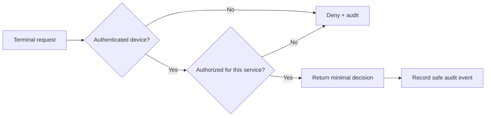

# OWASP Top 10:2025 — A Practical Guide for App Builders

**Code Therapist Knowledge Hub · 8 November 2026 · Cybersecurity / Secure Development**

> **Source status:** Original explanatory educational article based on OWASP's officially released **Top 10:2025**. This is not an OWASP-endorsed guide, a penetration-testing authorization, or a report of newly discovered vulnerabilities.

## What changed?

OWASP identifies the most important categories of web application security risk. Its **2025** edition supersedes the 2021 list and emphasizes access control, configuration and software supply-chain security. A category is a class of risk—not proof that a specific app has a vulnerability.

| Rank | OWASP 2025 category | What a developer should examine |
|---|---|---|
| A01 | Broken Access Control | Check permissions on **every** API request, not just hide buttons |
| A02 | Security Misconfiguration | Review defaults, unnecessary services, headers and deployment settings |
| A03 | Software Supply Chain Failures | Inventory dependencies and verify trusted build/release sources |
| A04 | Cryptographic Failures | Protect secrets and sensitive data using maintained cryptographic libraries |
| A05 | Injection | Use parameterized queries and safe output encoding |
| A06 | Insecure Design | Threat-model workflows before writing code |
| A07 | Authentication Failures | Use robust login, MFA where appropriate and session handling |
| A08 | Software or Data Integrity Failures | Validate update and data trust boundaries |
| A09 | Security Logging and Alerting Failures | Record important security events without exposing secrets |
| A10 | Mishandling of Exceptional Conditions | Handle errors safely and fail closed where necessary |

## Example: a finance-status API

Suppose an IoT smart-card terminal calls `GET /api/student/123/finance-status`. Even if the interface only shows “CLEARED” or “PENDING”, the server must **authenticate the terminal** and **authorize its finance role**. A library terminal must not be able to request the same endpoint merely by changing a URL or service parameter.

This design addresses access-control concerns, but is **not sufficient on its own**: credential security, replay prevention, TLS, card cloning and privacy still need dedicated controls.

## Five safe actions this week

1. Inventory your apps, services, libraries and production endpoints.
2. Map which roles may read or modify each resource; write **negative tests** for unauthorized access.
3. Enable dependency and secret scanning where supported, then investigate alerts.
4. Use parameterized SQL and keep secrets out of source control.
5. Test failure modes: expired session, invalid token, unreachable database and malformed input.

## A small defensive test matrix

| Scenario | Expected |
|---|---|
| Anonymous request to protected endpoint | 401 or equivalent unauthenticated response |
| Authenticated user accessing another user's restricted record | 403 or appropriately concealed resource |
| Library device requesting finance clearance | Denied and auditable |
| SQL metacharacters in input | Treated as data, not executable SQL |
| Database unavailable | Safe error; no accidental “approved” state |

HTTP status choices depend on application policy; avoid leaking whether sensitive resources exist.

## Primary sources and rights

- **OWASP Foundation — Top 10 project:** https://owasp.org/projects/Top-Ten/
- **Official OWASP Top 10:2025 documentation:** https://top10.owasp.org/2025/
- **OWASP-maintained GitHub repository:** https://github.com/OWASP/Top10

**Original source release:** 2025 edition, confirmed current by OWASP as of 8 November 2026. **Rights:** This article is an original summary and original example; OWASP's category names are attributed, not represented as Code Therapist's invention. Readers should consult the original project for OWASP's own copyright and licensing terms before republishing its text, images or tables. No third-party graphics or substantial passages have been copied.

[← Cybersecurity Hub](../README.md) · [← Knowledge Hub](../../README.md)
