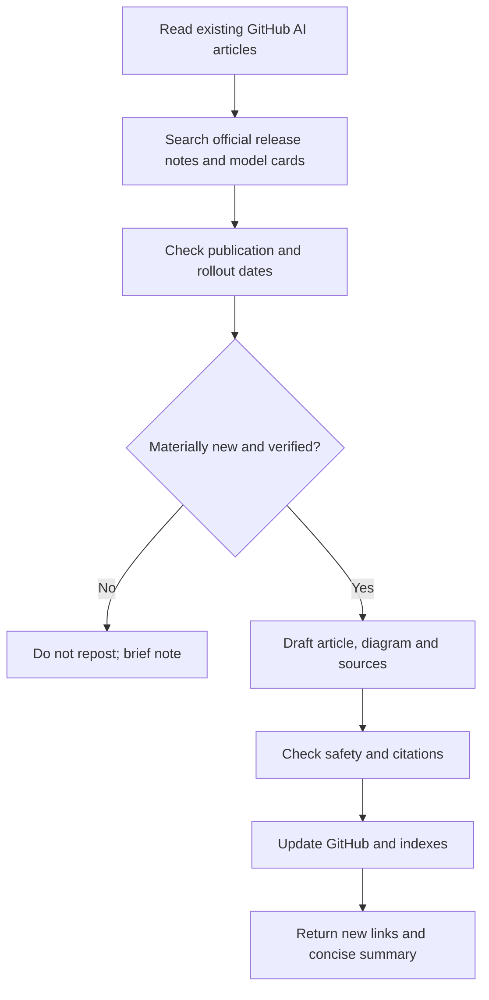

# 🗓️ AI Academy — Editorial Standard & Daily Updates

**Maintainer:** Code Therapist / ByteLab Uganda Ltd · **Policy version:** 1.0 · **Adopted:** 9 November 2026

[← AI Academy](./README.md) · [Model catalog](./MODEL-CATALOG.md) · [AI news digest](./NEWS/README.md)

## Purpose

Keep AI education **organized, current, attributable and free-to-read**. A daily monitoring task is scheduled for the Uganda morning to review official model releases, educational resources and safety changes. It should avoid duplicate articles and only publish factual updates when supported by available sources and permitted GitHub access.

## Publication requirements

| Element | Required practice |
|---|---|
| **Title** | Specific subject, model family and clear learner level |
| **Small landscape graphic** | Original 16:9 or near-landscape SVG/approved image; meaningful alt text |
| **Structured lecture** | Definition, background, use case, technical details, limitations |
| **Flow diagrams** | Mermaid process / architecture when a process needs explanation |
| **Practical work** | Safe hands-on exercise or research worksheet with expected evidence |
| **Sources** | Links to provider announcement/model card and independent reference when useful |
| **Dates** | Distinguish incident or release date, source publication date and editorial review |
| **Safety** | No secrets, private records, unsupported legal/health/financial advice |
| **Accuracy** | Correct terminology, actual product vs model, licence and source limitations |
| **Indexing** | Link from academy README, relevant class/model and news categories |
| **Updates** | Revise when genuinely changed; retain original historical facts; record corrections |
| **Accessibility** | Readable headings, descriptive graphics, plain-language summaries |

## Daily research process

### What counts as a meaningful update?

A new model or model-card version, confirmed retirement, feature availability change, credible incident/safety note, substantial published training resource or material correction to a previously cited article.

**Do not** generate a new article solely because it is a new day. Do not describe a corporate press release as independent measurement. Do not assert that a scheduled task created content unless its publication can be verified.

## Freshness and correction handling

Maintain the original announcement and publication dates. For changing features, add “last checked” and a dated note explaining what changed. Update links when URLs move, preserving original source attribution where feasible. If a reliable source contradicts an earlier entry, annotate the disagreement and correction rather than silently replacing the historical account.

## Suggested rotating study focus

- **Foundations:** terminology and responsible use
- **Model literacy:** architectures, modalities, evaluation and licenses
- **Productivity:** prompting, writing, research and code
- **Builders:** tools, RAG, agents and safe automation
- **Research brief:** official model-card/news updates and credibility check

## Human responsibilities

A student must complete class exercises and report their own results. Any real publication, payments, GitHub repository modification or communication through third-party services should respect permissions and tool access. The Academy does not automatically award course certificates.

[← Academy](./README.md)
