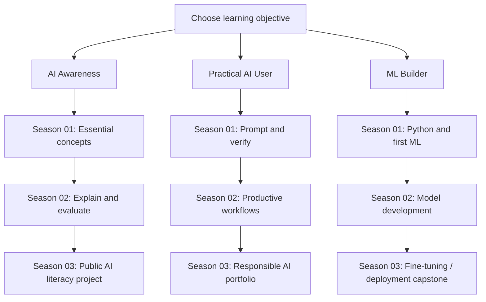

# 🎓 General AI Learning — Three Independent Routes

**Code Therapist AI Academy · Revised 9 November 2026**

[← Academy home](./README.md) · [Model Research](./MODEL-RESEARCH/README.md) · [Hugging Face](./PLATFORMS/HUGGING-FACE/README.md)

## Choose based on what you actually want

| Track | Intended learner | Start Season 01 | Day 001 |
|---|---|---|---|
| **AI Awareness & Literacy** | Curious people who just want to understand AI | [Introductory pathway](./PATH-01-AI-LITERACY/README.md) | [What is AI?](./PATH-01-AI-LITERACY/SEASON-01/DAY-001-WHAT-IS-AI.md) |
| **Practical AI User** | Students, creators, office workers, entrepreneurs | [Practical pathway](./PATH-02-PRACTICAL-AI/README.md) | [First AI Session](./PATH-02-PRACTICAL-AI/SEASON-01/DAY-001-FIRST-AI-SESSION.md) |
| **Machine Learning Builder** | Python learners, data analysts, developers and ML engineers | [Builder pathway](./PATH-03-ML-BUILDER/README.md) | [Python and data](./PATH-03-ML-BUILDER/SEASON-01/DAY-001-PYTHON-DATA.md) |

## Academic flow

## Day rules

*Days are lesson numbers*, not proof of a student's actual calendar attendance. Each day contains definitions, a short lecture, a diagram, a learning exercise, a quiz and credible links. Learners may start at their own pace; Day 001 does not need to be read on the calendar date of publication.

## Model research belongs elsewhere

If a user wants **the history of Claude**, they should go to the [Claude research folder](./MODEL-RESEARCH/CLAUDE/README.md). If they want **all updated model versions**, see the [release research directory](./MODEL-RESEARCH/README.md) and [AI news](./NEWS/README.md). If they want **model repositories, datasets or training infrastructure**, see [Hugging Face](./PLATFORMS/HUGGING-FACE/README.md).

## Existing cross-cutting lectures

The earlier [three-season 12-class curriculum](./SEASON-01/README.md) remains available as supplemental learning; these new **three independent tracks** are the primary beginner-to-builder navigation, and existing lessons are not deleted or silently altered.

[← AI Academy](./README.md)
