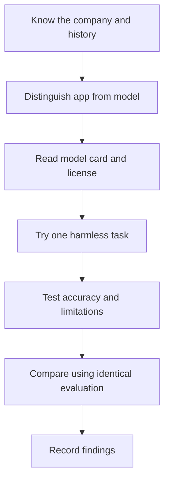

# 🧠 First 15 AI Model Families — Research Catalog

**Code Therapist AI Academy · Reviewed 9 November 2026**

[AI Academy](./README.md) · [Season One](./SEASON-01/README.md) · [Season Two](./SEASON-02/README.md) · [Season Three](./SEASON-03/README.md)

> [!IMPORTANT]
> **Clarification:** ChatGPT, Gemini and similar names can denote **consumer apps** as well as underlying **model families**. Perplexity is a search-answer product; **Sonar** is its model/API family. Llama and Gemma have downloadable weights but separate licenses. This catalog is educational, not a ranking or a claim that all models are free or offered in every location. No unsupported “best model” comparisons.

## First 15 families

| # | AI family | Developer | Origin / milestone | Focus | Study profile |
|---:|---|---|---|---|---|
| 01 | **[GPT / ChatGPT](./MODELS/GPT-CHATGPT.md)** | OpenAI | 2022 ChatGPT launch | Assistant & GPT models | [Open class](./MODELS/GPT-CHATGPT.md) |
| 02 | **[Claude](./MODELS/CLAUDE.md)** | Anthropic | Mar 2023 | Assistant & text models | [Open class](./MODELS/CLAUDE.md) |
| 03 | **[Gemini](./MODELS/GEMINI.md)** | Google | Dec 2023 | Multimodal family | [Open class](./MODELS/GEMINI.md) |
| 04 | **[Grok](./MODELS/GROK.md)** | xAI | Nov 2023 | Assistant and model family | [Open class](./MODELS/GROK.md) |
| 05 | **[Llama](./MODELS/LLAMA.md)** | Meta | 2023 | Open-weight, custom license | [Open class](./MODELS/LLAMA.md) |
| 06 | **[DeepSeek](./MODELS/DEEPSEEK.md)** | DeepSeek | 2023 onward | Reasoning / coding family | [Open class](./MODELS/DEEPSEEK.md) |
| 07 | **[Qwen](./MODELS/QWEN.md)** | Alibaba | 2023 | Multilingual, varied licensing | [Open class](./MODELS/QWEN.md) |
| 08 | **[Mistral](./MODELS/MISTRAL.md)** | Mistral AI | 2023 | Open and commercial offerings | [Open class](./MODELS/MISTRAL.md) |
| 09 | **[Phi](./MODELS/PHI.md)** | Microsoft | 2023 | Small language models | [Open class](./MODELS/PHI.md) |
| 10 | **[Gemma](./MODELS/GEMMA.md)** | Google | Feb 2024 | Open-weight family | [Open class](./MODELS/GEMMA.md) |
| 11 | **[Command / Command R](./MODELS/COMMAND.md)** | Cohere | Mar 2024 Command R | Enterprise RAG / tool use | [Open class](./MODELS/COMMAND.md) |
| 12 | **[Granite](./MODELS/GRANITE.md)** | IBM | 2023–24 | Enterprise / open models | [Open class](./MODELS/GRANITE.md) |
| 13 | **[Amazon Nova](./MODELS/NOVA.md)** | Amazon AWS | Dec 2024 | AWS foundation models | [Open class](./MODELS/NOVA.md) |
| 14 | **[Kimi](./MODELS/KIMI.md)** | Moonshot AI | 2023 | Long-context assistant family | [Open class](./MODELS/KIMI.md) |
| 15 | **[Sonar](./MODELS/SONAR.md)** | Perplexity AI | 2025 Sonar family | Search-grounded model/API | [Open class](./MODELS/SONAR.md) |

## How to study any AI model

## 🧪 Structured evaluation practicum

Use the **[Model Evaluation Lab](./MODEL-EVALUATION-LAB.md)** to compare ChatGPT, Claude, Gemini and other accessible systems on an identical fictional task. Record actual model version, date, tools, accuracy, cost/access and limitations; the lab includes a 100-mark scorecard.

## Recommended practical comparisons

1. **Beginners:** Ask two models to explain an HTML element in 100 words. Compare clarity and factual accuracy.
2. **Students:** Supply a **fictional** assignment topic. Compare proposed outlines and source credibility.
3. **Developers:** Run the same Python function-generation task and compare **unit tests**, not subjective style.
4. **Business:** Compare anonymized simulated inventory summaries and test whether the assistant respects constraints.
5. **Research:** Ask for citation-backed claims, open each source and note any unsupported conclusions.

### What the scorecard should track

| Criterion | Measurement |
|---|---|
| Accuracy | Correct facts / total checked claims |
| Usefulness | Completes the specified task |
| Privacy | Where inputs are sent, retained and used |
| Accessibility | Account, device, cost and region restrictions |
| Reproducibility | Exact product, model version, date and settings |
| Licensing | Hosted API, open weight, commercial or custom terms |

## Official references

- **GPT / ChatGPT:** [Provider source](https://openai.com/index/chatgpt/)
- **Claude:** [Provider source](https://www.anthropic.com/news/introducing-claude)
- **Gemini:** [Provider source](https://blog.google/innovation-and-ai/technology/ai/google-gemini-ai/)
- **Grok:** [Provider source](https://x.ai/news/grok)
- **Llama:** [Provider source](https://ai.meta.com/llama/)
- **DeepSeek:** [Provider source](https://www.deepseek.com/en/news/)
- **Qwen:** [Provider source](https://qwenlm.github.io/)
- **Mistral:** [Provider source](https://mistral.ai/news)
- **Phi:** [Provider source](https://www.microsoft.com/en-us/research/project/phi/)
- **Gemma:** [Provider source](https://ai.google.dev/gemma)
- **Command / Command R:** [Provider source](https://cohere.com/blog/command-r)
- **Granite:** [Provider source](https://www.ibm.com/granite)
- **Amazon Nova:** [Provider source](https://aws.amazon.com/ai/generative-ai/nova/)
- **Kimi:** [Provider source](https://www.kimi.com/)
- **Sonar:** [Provider source](https://docs.perplexity.ai/guides/sonar-quickstart)

**Update standard:** Existing model profiles should be revised only after checking official dated model cards or release notes. Do not silently overwrite historical versions or claim that old dates indicate current market leadership.

[← AI Academy](./README.md)
