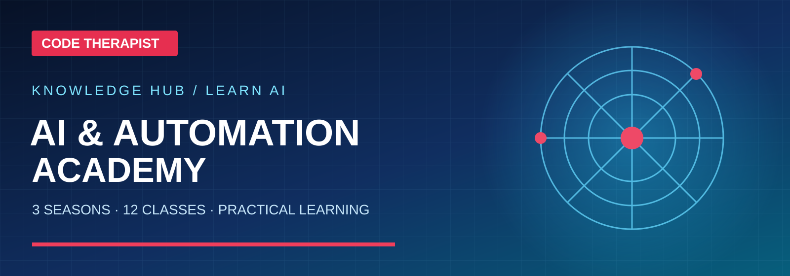

# 🧠 First 15 AI Model Families — Research Catalog

**Code Therapist AI Academy · Reviewed 9 November 2026**

[AI Academy](./README.md) · [Season One](./SEASON-01/README.md) · [Season Two](./SEASON-02/README.md) · [Season Three](./SEASON-03/README.md)

> [!IMPORTANT]
> **Clarification:** ChatGPT, Gemini and similar names can denote **consumer apps** as well as underlying **model families**. Perplexity is a search-answer product; **Sonar** is its model/API family. Llama and Gemma have downloadable weights but separate licenses. This catalog is educational, not a ranking or a claim that all models are free or offered in every location. No unsupported “best model” comparisons.

## First 15 families — visual study directory

Browse by number, preview and name, just like the Technology Education section.

| # | Small landscape card | Model family and focus | Open |
|:---:|:---|---|:---|
| **01** | <a href="./MODELS/GPT-CHATGPT.md">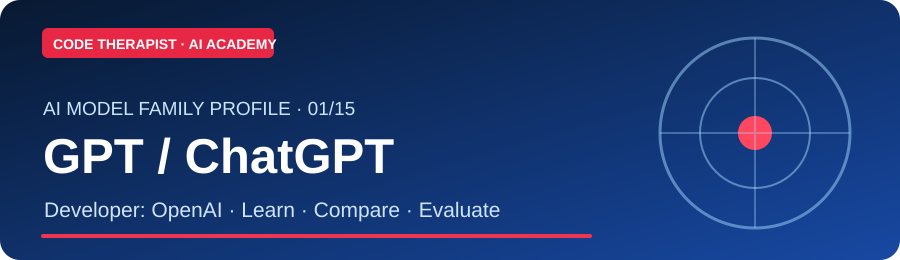</a> | **GPT / ChatGPT** · OpenAI  Assistant and GPT model family | [Read & Study](./MODELS/GPT-CHATGPT.md) |
| **02** | <a href="./MODELS/CLAUDE.md">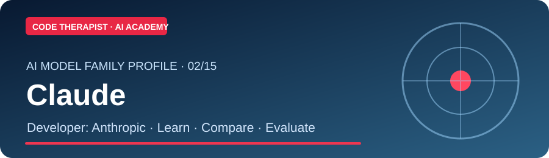</a> | **Claude** · Anthropic  Writing, coding and reasoning | [Read & Study](./MODELS/CLAUDE.md) |
| **03** | <a href="./MODELS/GEMINI.md">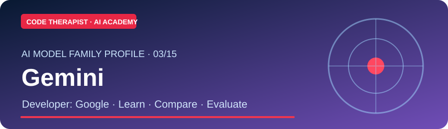</a> | **Gemini** · Google  Multimodal AI | [Read & Study](./MODELS/GEMINI.md) |
| **04** | <a href="./MODELS/GROK.md">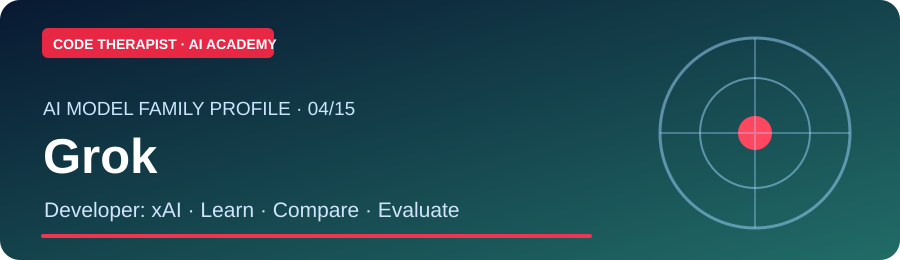</a> | **Grok** · xAI  Assistant and model family | [Read & Study](./MODELS/GROK.md) |
| **05** | <a href="./MODELS/LLAMA.md">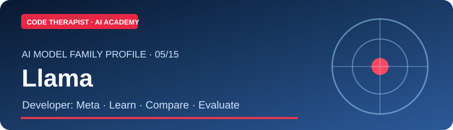</a> | **Llama** · Meta  Open-weight models | [Read & Study](./MODELS/LLAMA.md) |
| **06** | <a href="./MODELS/DEEPSEEK.md">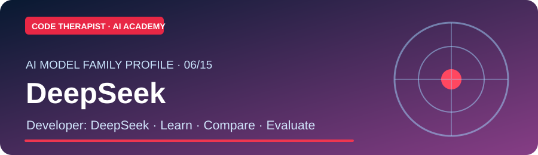</a> | **DeepSeek** · DeepSeek  Reasoning and coding | [Read & Study](./MODELS/DEEPSEEK.md) |
| **07** |  | **Qwen** · Alibaba  Multilingual models | [Read & Study](./MODELS/QWEN.md) |
| **08** | <a href="./MODELS/MISTRAL.md">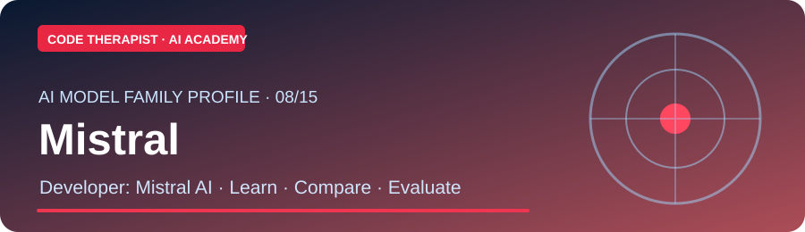</a> | **Mistral** · Mistral AI  Open and commercial models | [Read & Study](./MODELS/MISTRAL.md) |
| **09** | <a href="./MODELS/PHI.md">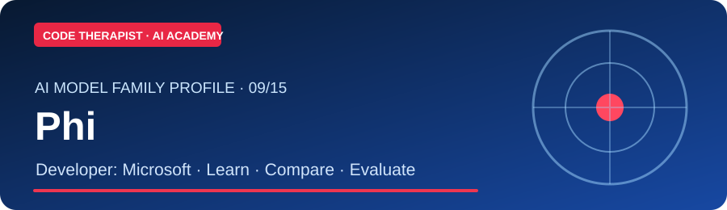</a> | **Phi** · Microsoft  Small language models | [Read & Study](./MODELS/PHI.md) |
| **10** | <a href="./MODELS/GEMMA.md">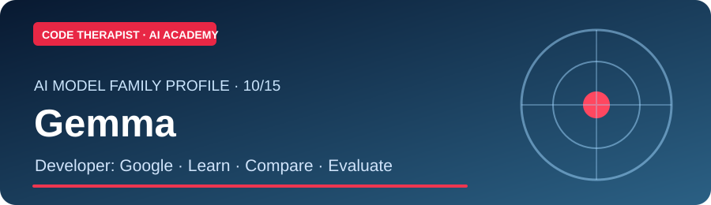</a> | **Gemma** · Google  Open-weight models | [Read & Study](./MODELS/GEMMA.md) |
| **11** | <a href="./MODELS/COMMAND.md">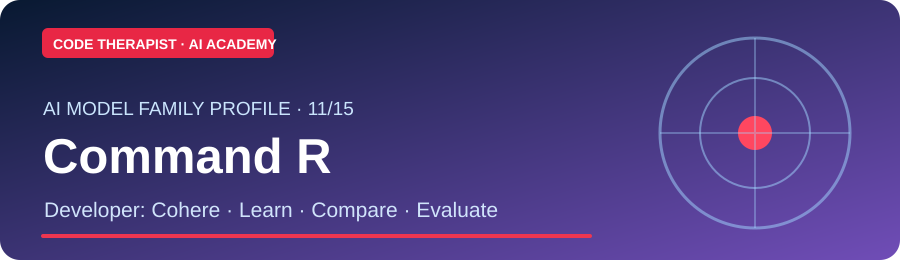</a> | **Command / Command R** · Cohere  Enterprise retrieval and tools | [Read & Study](./MODELS/COMMAND.md) |
| **12** | <a href="./MODELS/GRANITE.md">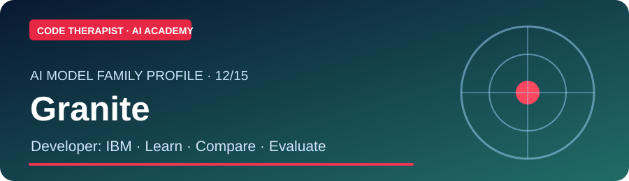</a> | **Granite** · IBM  Enterprise models | [Read & Study](./MODELS/GRANITE.md) |
| **13** | <a href="./MODELS/NOVA.md">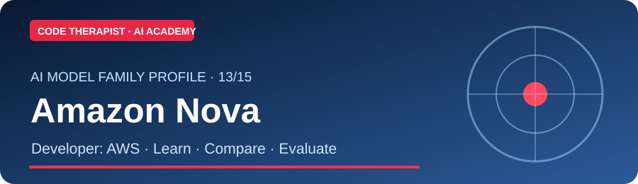</a> | **Amazon Nova** · Amazon AWS  Cloud foundation models | [Read & Study](./MODELS/NOVA.md) |
| **14** | <a href="./MODELS/KIMI.md">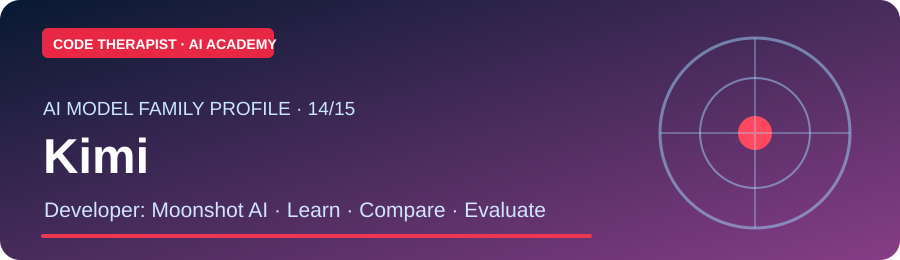</a> | **Kimi** · Moonshot AI  Long-context assistance | [Read & Study](./MODELS/KIMI.md) |
| **15** | <a href="./MODELS/SONAR.md">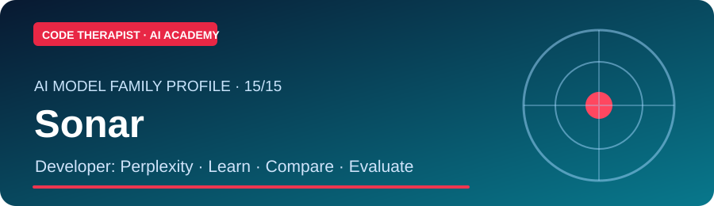</a> | **Sonar** · Perplexity AI  Search-grounded answers | [Read & Study](./MODELS/SONAR.md) |

## How to study any AI model

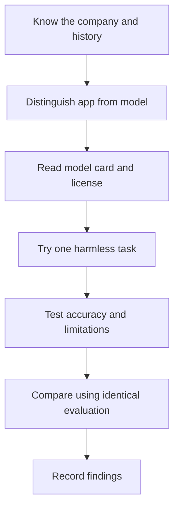

## 🧪 Structured evaluation practicum

Use the **[Model Evaluation Lab](./MODEL-EVALUATION-LAB.md)** to compare ChatGPT, Claude, Gemini and other accessible systems on an identical fictional task. Record actual model version, date, tools, accuracy, cost/access and limitations; the lab includes a 100-mark scorecard.

## Recommended practical comparisons

1. **Beginners:** Ask two models to explain an HTML element in 100 words. Compare clarity and factual accuracy.
2. **Students:** Supply a **fictional** assignment topic. Compare proposed outlines and source credibility.
3. **Developers:** Run the same Python function-generation task and compare **unit tests**, not subjective style.
4. **Business:** Compare anonymized simulated inventory summaries and test whether the assistant respects constraints.
5. **Research:** Ask for citation-backed claims, open each source and note any unsupported conclusions.

### What the scorecard should track

| Criterion | Measurement |
|---|---|
| Accuracy | Correct facts / total checked claims |
| Usefulness | Completes the specified task |
| Privacy | Where inputs are sent, retained and used |
| Accessibility | Account, device, cost and region restrictions |
| Reproducibility | Exact product, model version, date and settings |
| Licensing | Hosted API, open weight, commercial or custom terms |

## Official references

- **GPT / ChatGPT:** [Provider source](https://openai.com/index/chatgpt/)
- **Claude:** [Provider source](https://www.anthropic.com/news/introducing-claude)
- **Gemini:** [Provider source](https://blog.google/innovation-and-ai/technology/ai/google-gemini-ai/)
- **Grok:** [Provider source](https://x.ai/news/grok)
- **Llama:** [Provider source](https://ai.meta.com/llama/)
- **DeepSeek:** [Provider source](https://www.deepseek.com/en/news/)
- **Qwen:** [Provider source](https://qwenlm.github.io/)
- **Mistral:** [Provider source](https://mistral.ai/news)
- **Phi:** [Provider source](https://www.microsoft.com/en-us/research/project/phi/)
- **Gemma:** [Provider source](https://ai.google.dev/gemma)
- **Command / Command R:** [Provider source](https://cohere.com/blog/command-r)
- **Granite:** [Provider source](https://www.ibm.com/granite)
- **Amazon Nova:** [Provider source](https://aws.amazon.com/ai/generative-ai/nova/)
- **Kimi:** [Provider source](https://www.kimi.com/)
- **Sonar:** [Provider source](https://docs.perplexity.ai/guides/sonar-quickstart)

**Update standard:** Existing model profiles should be revised only after checking official dated model cards or release notes. Do not silently overwrite historical versions or claim that old dates indicate current market leadership.

[← AI Academy](./README.md)
