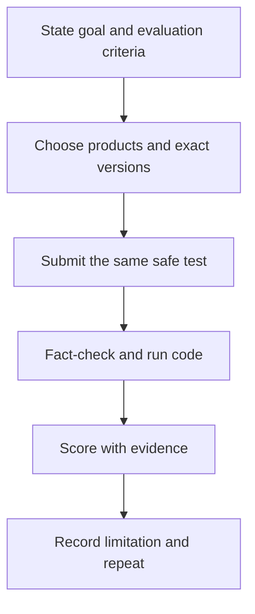

# 🧪 Cross-Model AI Evaluation Lab — Beginner to Advanced

**Code Therapist AI Academy · Practical assessment · Reviewed 9 November 2026**

[← Academy home](./README.md) · [First 15 model families](./MODEL-CATALOG.md) · [Prompt handbook](./PROMPT-ENGINEERING-HANDBOOK.md) · [AI news](./NEWS/README.md)

> This lab compares **observed responses for one chosen task**. It does not declare a universal winner between ChatGPT, Claude, Gemini or any of the 15 families. Access may depend on country, user plan and the selected version.

## Objective

Choose 2–3 AI systems you can legitimately access and compare their responses to the **same safe prompt** with clear criteria. Record the precise *product*, *model identifier if shown*, *date*, *settings*, *task* and *result*. Never infer exact model identity if an app does not expose it.

## Three levels

| Level | Safe evaluation task | Main outcome |
|---|---|---|
| **Beginner** | Explain what an algorithm is to a 15-year-old | Clarity, accuracy, age-appropriate explanation |
| **Intermediate** | Generate a Python function and test it | Syntax, correctness, tests and security |
| **Advanced** | Analyze a synthetic inventory dataset and suggest reorder policies | Traceability, arithmetic, constraints and business usefulness |

## Prompt engineering experiment

### Before: vague

```text
Tell me about programming.
```

### After: structured

```text
Role: Patient computer science tutor.
Audience: Ugandan student new to programming.
Task: Explain Python variables, integer vs string types, and one if-statement.
Constraints: 250 words maximum, no invented facts, use fictional UGX examples.
Format: three short definitions, one runnable code example, and a 5-question quiz.
Verification: list what a learner should run to confirm the example works.
```

### Observe and revise



## Model comparison scorecard

| Metric | Measurement (example) | Max marks |
|---|---|---:|
| Factual accuracy | Correct facts against sources | 30 |
| Following instructions | Required format, length, constraints | 20 |
| Technical correctness | Executable code / validated outputs | 20 |
| Transparency | Cautions and unsupported claims identified | 15 |
| Useful communication | Clear explanation for target audience | 15 |
| **Total** | **Sum out of 100** | **100** |

### Blank evaluation template

| Product / exact model | Date and access type | Accuracy /30 | Instructions /20 | Correctness /20 | Transparency /15 | Clarity /15 | Total |
|---|---|---:|---:|---:|---:|---:|---:|
| Product A / model unknown or specified | | | | | | | |
| Product B / model unknown or specified | | | | | | | |
| Product C / model unknown or specified | | | | | | | |

The table has no manufactured results. **Learners must populate it from actual observed tests.**

## Why scores alone are insufficient

Models can change within an app. Tools, search capability, context length, data policies and subscription requirements may differ. An assessment that compares one product with web browsing turned on to another without browsing is **not a pure model-quality comparison**. Likewise, open-weight licensing does not automatically mean permission for every use.

## Evaluation standards and references

- [Google Machine Learning Crash Course](https://developers.google.com/machine-learning/crash-course)
- [OpenAI prompting guide](https://platform.openai.com/docs/guides/prompt-engineering)
- [Anthropic prompting guide](https://docs.anthropic.com/en/docs/build-with-claude/prompt-engineering/overview)
- [NIST AI Risk Management Framework](https://www.nist.gov/itl/ai-risk-management-framework)
- [MCP protocol introduction](https://modelcontextprotocol.io/introduction)

## Capstone submission

Submit a **one-page report** with the original prompt, two outputs summarized in your own words, results of testing, the filled scorecard, sources, and a reflection describing where the model made mistakes. Use synthetic inputs only; do not share private health, educational or bank records.

[← Return to academy](./README.md)
