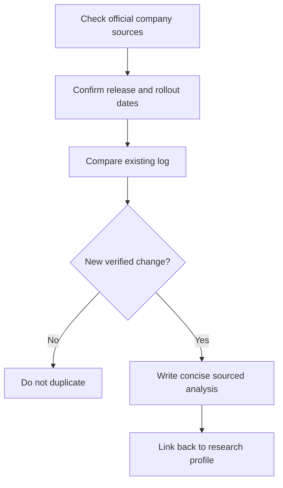

# 📰 Claude — Model Release and Update Log

**Company:** Anthropic · **Log opened:** 9 November 2026

[← Claude Research Section](./README.md) · [Official release sources](https://www.anthropic.com/news) · [AI Academy News Desk](../../NEWS/README.md)

## What we track

Product launches, model versions, revised model cards, capability changes, API deprecations, availability/region changes, licensing and verified safety incidents. Each update must include exact source and publication dates, factual change versus previous version, and a note about unresolved claims.

| Update | Date | Evidence |
|---|---|---|
| **Historical starting point** | 2023 | Claude introduced March 2023. [Official documentation/release index](https://www.anthropic.com/news) |

## New verified model release — 9 November 2026 (reviewed 10 November)

**Claude Fable 5.2 / Claude Mythos 5.2:** Anthropic announced two differently safeguarded/access-controlled offerings of the **same underlying model**. Fable 5.2 is broadly available on supported platforms; Mythos 5.2 requires applicable cyber or life-sciences verification for sensitive uses. Anthropic lists standard API prices of **$8 per million input tokens** and **$40 per million output tokens**; optional fast mode is **$16/$80**. Anthropic reports up to 30% faster generation than 5.1; this is a **vendor claim**, not an independent Code Therapist measurement.

- **Official announcement:** [Anthropic, 9 November 2026](https://www.anthropic.com/claude-fable-and-mythos-5-2)
- **Educational analysis, access distinction, safety and exercise:** [10 November release research](../../NEWS/2026-11-10-CLAUDE-FABLE-MYTHOS-5-2.md)
- **Scope:** Model release and availability/pricing, not a new company; access and prices may vary by platform.

## Dated model-specific research entry — 7 October 2026

**Claude Haiku 5.5** — Anthropic introduced a smaller/faster Claude option for high-throughput tasks. Model availability, prices and vendor comparisons depend on the exact selected API or plan.

- **Announced:** 7 October 2026
- **Primary source:** [Anthropic Claude Haiku 5.5](https://www.anthropic.com/claude-haiku-5-5)
- **Evidence status:** A provider announcement, not independently reproduced latency or accuracy.
- **Student lab:** Create five fictional support questions, record correct outputs and compare performance under a documented model version.
- **Related:** [9 November research watch](../../NEWS/2026-11-09-MODEL-RELEASE-WATCH.md)

**New release entries:** Add only after an official dated source has been reviewed. The absence of a new item here does not establish that the provider released nothing. The main [Academy news digest](../../NEWS/README.md) also aggregates announcements across models.

## Editorial workflow

[← Research profile](./README.md)
