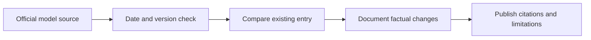

# 📰 Cohere Command / Command R — Release and Update Log

**Organization:** Cohere · **Log opened 9 November 2026**

[← Cohere Command / Command R research](./README.md) · [AI News Hub](../../NEWS/README.md)

## Historical baseline

Command R was introduced in 2024 for retrieval-focused enterprise tasks. This is a historical overview, **not a newly announced release**. For updates, consult [official provider documentation](https://docs.cohere.com/changelog).

## New release log

| Release date | Model/version | What changed | Source |
|---|---|---|---|
| — | _No newly reviewed version in this section yet_ | Update only after official date and evidence are confirmed | [Official updates](https://docs.cohere.com/changelog) |

Keep company product announcements separate from independent evaluation claims. Model weights, subscriptions, APIs and geographical availability may differ.

[← Model Research](./README.md)
