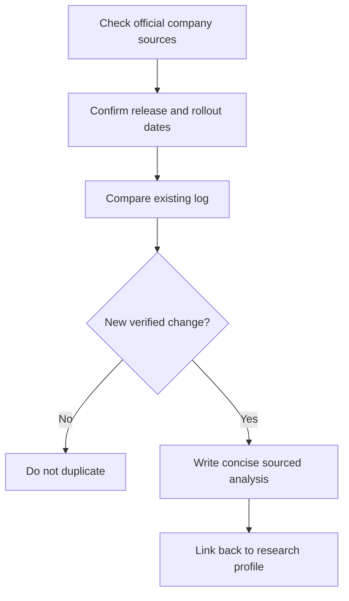

# 📰 DeepSeek — Model Release and Update Log

**Company:** DeepSeek · **Log opened:** 9 November 2026

[← DeepSeek Research Section](./README.md) · [Official release sources](https://api-docs.deepseek.com/updates/) · [AI Academy News Desk](../../NEWS/README.md)

## What we track

Product launches, model versions, revised model cards, capability changes, API deprecations, availability/region changes, licensing and verified safety incidents. Each update must include exact source and publication dates, factual change versus previous version, and a note about unresolved claims.

| Update | Date | Evidence |
|---|---|---|
| **Historical starting point** | 2023 | Model family and company emerged 2023. [Official documentation/release index](https://api-docs.deepseek.com/updates/) |

## Dated model-specific research entry — 10 September 2026

**DeepSeek-V4.1-Flash** — DeepSeek's developer update describes a version focused on visual input and model/API changes; claimed benchmarks are vendor-reported and require independent testing.

- **Published/reported:** 10 September 2026
- **Original source:** [Official provider information](https://api-docs.deepseek.com/updates/)
- **Interpretation:** This is a documented provider announcement, not a claim of independent benchmark performance or universal access.
- **Research exercise:** Read the full source, list two capabilities and two limitations, and identify what type of evidence you would need before recommending the system.
- **Cross-reference:** [AI Academy 9 November research watch](../../NEWS/2026-11-09-MODEL-RELEASE-WATCH.md)

**New release entries:** Add only after an official dated source has been reviewed. The absence of a new item here does not establish that the provider released nothing. The main [Academy news digest](../../NEWS/README.md) also aggregates announcements across models.

## Editorial workflow

[← Research profile](./README.md)
