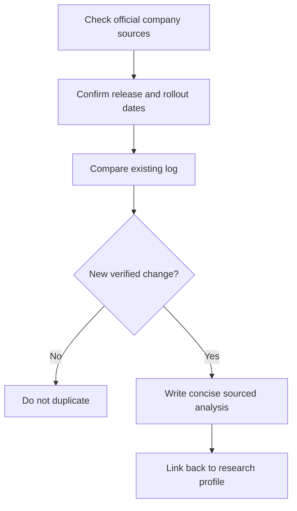

# 📰 GPT / ChatGPT — Model Release and Update Log

**Company:** OpenAI · **Log opened:** 9 November 2026

[← GPT / ChatGPT Research Section](./README.md) · [Official release sources](https://openai.com/news/) · [AI Academy News Desk](../../NEWS/README.md)

## What we track

Product launches, model versions, revised model cards, capability changes, API deprecations, availability/region changes, licensing and verified safety incidents. Each update must include exact source and publication dates, factual change versus previous version, and a note about unresolved claims.

| Update | Date | Evidence |
|---|---|---|
| **Historical starting point** | 2022 | ChatGPT launched November 2022; GPT research preceded the product. [Official documentation/release index](https://openai.com/news/) |

**New release entries:** Add only after an official dated source has been reviewed. The absence of a new item here does not establish that the provider released nothing. The main [Academy news digest](../../NEWS/README.md) also aggregates announcements across models.

## Editorial workflow

[← Research profile](./README.md)
