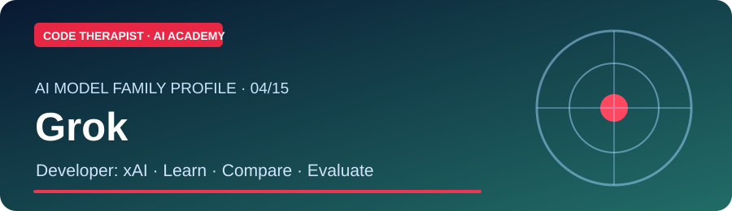
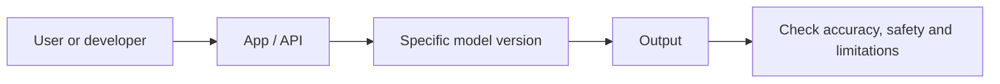

# 04 · Grok — Dedicated Research Section

**Company:** xAI · **Reviewed:** 9 November 2026

[← Model Research Home](../README.md) · [Full Technical Profile](../../MODELS/GROK.md) · [AI News](../../NEWS/README.md)

## Company and origin

Grok announced November 2023. For detailed founding background and official links, open the [full model-family profile](../../MODELS/GROK.md). Distinguish the company, consumer assistant and model version.

## How the AI works and is operated

An assistant and model family; live capabilities must be checked. In general, a user or application submits an input through an app/API, a chosen model processes it, and the user verifies the result. Underlying training data, weights, context limits, tools and subscriptions depend on the specific version.

## Research collections for this model

| Collection | What belongs here | Current content |
|---|---|---|
| **01 History and company** | Founding background, first release, organizational milestones | Summary above and [full profile](../../MODELS/GROK.md) |
| **02 How it operates** | Architecture, API, model input/output, deployment, permissions | Overview and official links |
| **03 Study lessons** | Introductory use, advanced prompting, evaluations and developer tasks | [AI Academy classes](../../README.md) |
| **04 Release updates** | Dated new versions, model cards, retirement and access changes | [Dedicated update log](./UPDATES.md) |
| **05 Official sources** | Primary documentation, papers, cards and announcements | [Official updates](https://x.ai/news) |

## Practical laboratory

Open the official model card or documentation, identify the exact version, run or design one **non-confidential** task, evaluate the result and write down the limitations. Use the [cross-model evaluation lab](../../MODEL-EVALUATION-LAB.md) for structured comparison.

## Publication rules

Do not treat marketing claims as independent benchmarks. Record the announcement date and availability date separately. Avoid inventing token prices, model performance or update dates. This page is a research index; full day-by-day course lessons belong to the general learner pathways, not mixed into company-specific news.

[← Model Research Directory](../README.md)
