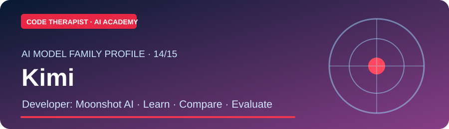
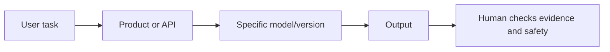

# Kimi — Dedicated AI Research Section

**Company:** Moonshot AI · **Updated:** 9 November 2026

[← Model Directory](../README.md) · [Detailed Model Profile](../../MODELS/KIMI.md) · [Update Log](./UPDATES.md)

## Company and origin

Kimi assistant products began appearing in 2023, with subsequent model updates. Learn the historical context and exact technical limitations in the [detailed profile](../../MODELS/KIMI.md) and [official provider documentation](https://platform.moonshot.ai/docs).

## How it operates

The user or software client sends a request to a service or model runtime. The exact model version processes that input under its own architecture, context window, permissions and hosting conditions. Never assume the consumer application and underlying model have identical capabilities.

## Separate research collections

| Category | Content |
|---|---|
| **Company & origin** | Kimi assistant products began appearing in 2023, with subsequent model updates. |
| **Architecture and operation** | [Technology, use cases and evaluation](../../MODELS/KIMI.md) |
| **Practical class** | [Model evaluation laboratory](../../MODEL-EVALUATION-LAB.md) |
| **Version/release updates** | [Dated dedicated updates](./UPDATES.md) |
| **Primary documentation** | [Official source](https://platform.moonshot.ai/docs) |

## Study assignment

Identify the model version, its license or access limits, common uses, one benchmark limitation and a safe fictional example. Write a 200-word analysis with a source link and the date checked.

> Company-specific release news belongs in this section. General “what is AI?” classes belong in the separate level-based learning pathways.

[← Model Research](../README.md)
