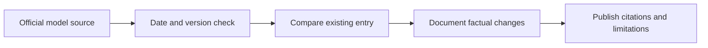

# 📰 Kimi — Release and Update Log

**Organization:** Moonshot AI · **Log opened 9 November 2026**

[← Kimi research](./README.md) · [AI News Hub](../../NEWS/README.md)

## Historical baseline

Kimi assistant products began appearing in 2023, with subsequent model updates. This is a historical overview, **not a newly announced release**. For updates, consult [official provider documentation](https://platform.moonshot.ai/docs).

## New release log

| Release date | Model/version | What changed | Source |
|---|---|---|---|
| — | _No newly reviewed version in this section yet_ | Update only after official date and evidence are confirmed | [Official updates](https://platform.moonshot.ai/docs) |

Keep company product announcements separate from independent evaluation claims. Model weights, subscriptions, APIs and geographical availability may differ.

[← Model Research](./README.md)
