# 🧠 Model & LLM Research — Companies, Families and Releases

**Code Therapist AI Academy** · 15 separate model/company sections · 9 November 2026

[← AI Academy](../README.md) · [General AI Courses](../LEARNING-PATHWAYS.md) · [Release News](../NEWS/README.md) · [Hugging Face](../PLATFORMS/HUGGING-FACE/README.md)

> These sections are **not the beginner teaching curriculum**. Each model has its own historical research, company origin, technology profile, practical investigation and **separate dated release log**. A version announcement is not an independently verified benchmark result.

## Model research directory — 15 independent sections

| # | Visual | Family / company | Research & updates |
|---:|---|---|---|
| 01 | [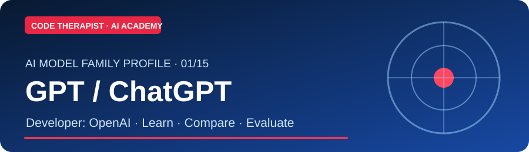](./GPT-CHATGPT/README.md) | **GPT / ChatGPT** · OpenAI | [Research](./GPT-CHATGPT/README.md) · [Release updates](./GPT-CHATGPT/UPDATES.md) |
| 02 | [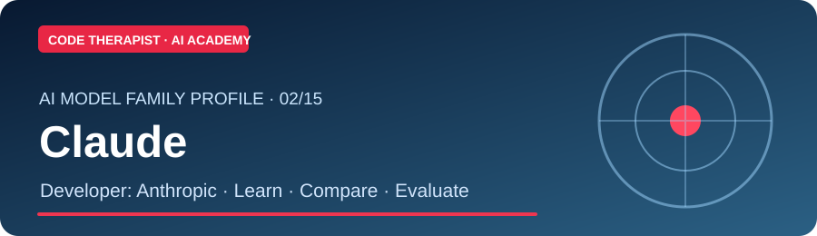](./CLAUDE/README.md) | **Claude** · Anthropic | [Research](./CLAUDE/README.md) · [Release updates](./CLAUDE/UPDATES.md) |
| 03 | [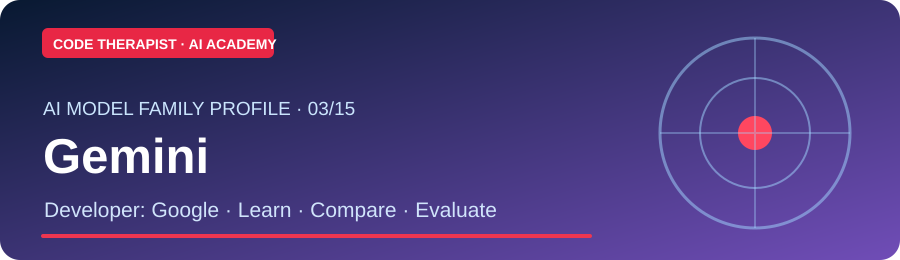](./GEMINI/README.md) | **Gemini** · Google | [Research](./GEMINI/README.md) · [Release updates](./GEMINI/UPDATES.md) |
| 04 |  | **Grok** · xAI | [Research](./GROK/README.md) · [Release updates](./GROK/UPDATES.md) |
| 05 | [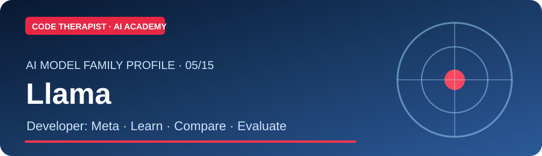](./LLAMA/README.md) | **Llama** · Meta | [Research](./LLAMA/README.md) · [Release updates](./LLAMA/UPDATES.md) |
| 06 | [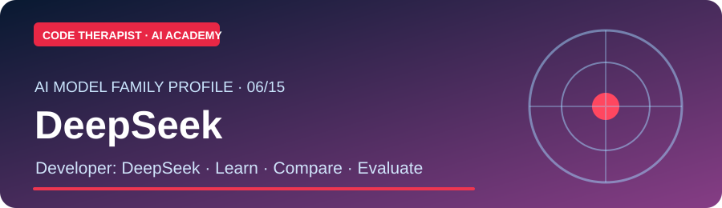](./DEEPSEEK/README.md) | **DeepSeek** · DeepSeek | [Research](./DEEPSEEK/README.md) · [Release updates](./DEEPSEEK/UPDATES.md) |
| 07 |  | **Qwen** · Alibaba | [Research](./QWEN/README.md) · [Release updates](./QWEN/UPDATES.md) |
| 08 | [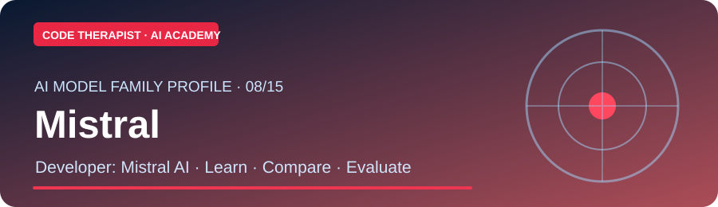](./MISTRAL/README.md) | **Mistral** · Mistral AI | [Research](./MISTRAL/README.md) · [Release updates](./MISTRAL/UPDATES.md) |
| 09 | [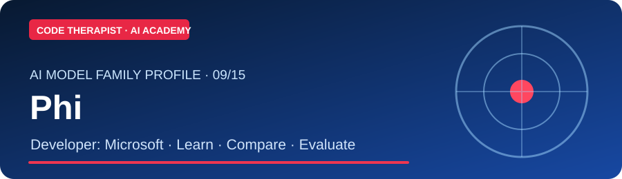](./PHI/README.md) | **Phi** · Microsoft | [Research](./PHI/README.md) · [Release updates](./PHI/UPDATES.md) |
| 10 | [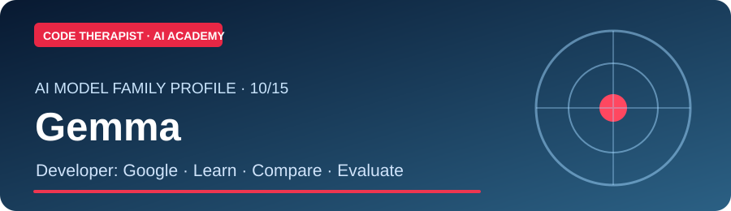](./GEMMA/README.md) | **Gemma** · Google | [Research](./GEMMA/README.md) · [Release updates](./GEMMA/UPDATES.md) |
| 11 | [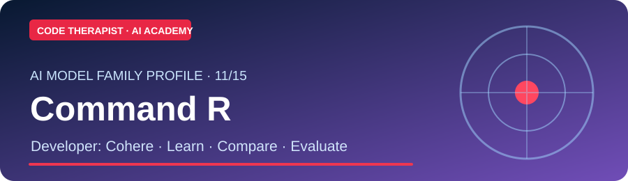](./COMMAND/README.md) | **Command R** · Cohere | [Research](./COMMAND/README.md) · [Release updates](./COMMAND/UPDATES.md) |
| 12 | [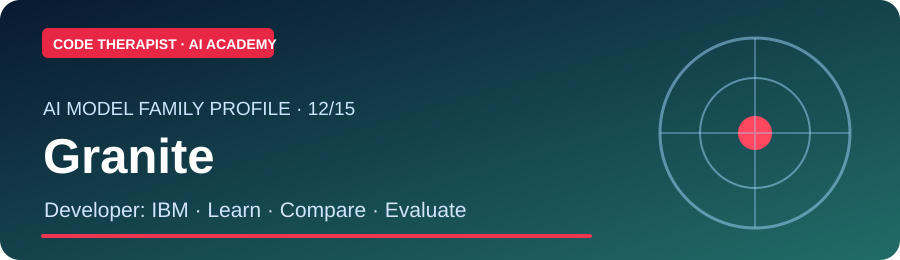](./GRANITE/README.md) | **Granite** · IBM | [Research](./GRANITE/README.md) · [Release updates](./GRANITE/UPDATES.md) |
| 13 |  | **Amazon Nova** · AWS | [Research](./NOVA/README.md) · [Release updates](./NOVA/UPDATES.md) |
| 14 | [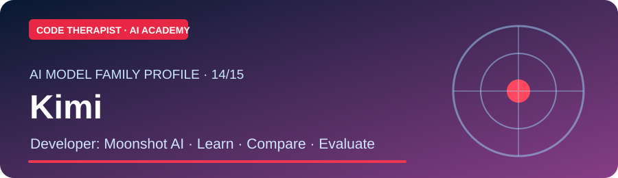](./KIMI/README.md) | **Kimi** · Moonshot AI | [Research](./KIMI/README.md) · [Release updates](./KIMI/UPDATES.md) |
| 15 | [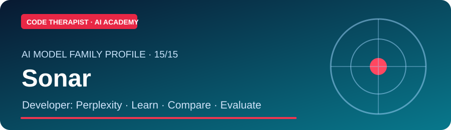](./SONAR/README.md) | **Sonar** · Perplexity | [Research](./SONAR/README.md) · [Release updates](./SONAR/UPDATES.md) |

## Model-specific publication method

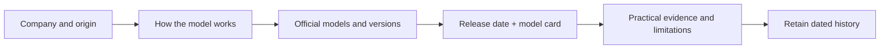

### Research template

For every update, record **provider, announcement date, rollout date, exact model/version, API/app distinctions, input/output modalities, benchmark methodology, license/price if officially stated, security and privacy limitations, source link and date checked**.

**[Release research curriculum — Season 01](./RELEASE-SEASON-01/README.md)** teaches how to read and assess model announcements. It does not replace the company-specific update logs.

[← Academy](../README.md)
