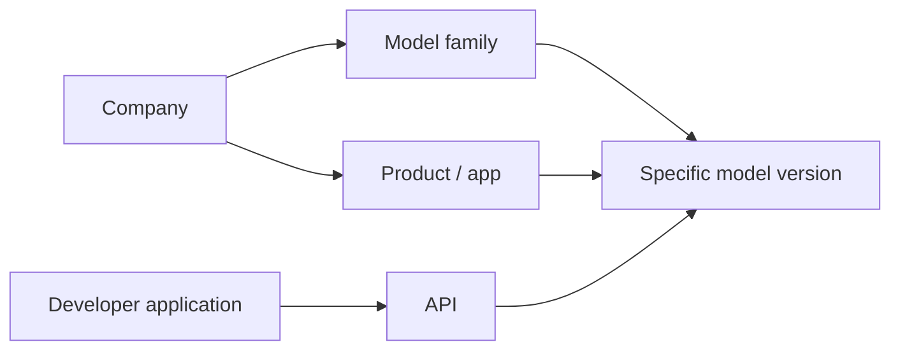

# Day 001 — Company, Chatbot, Model and API Are Different

[← Release Season 01](./README.md) · [Model Research](../README.md)

## Reading lecture

**Company** is the organization that develops or distributes AI technology. **Product or app** is the interface people use. **Model family** groups related learned systems. **Model version** specifies one release or checkpoint. **API** is a software interface developers may use to reach a hosted model; some families are also distributed as downloadable weights.

**Example:** OpenAI (organization), ChatGPT (product), GPT (model family), a named GPT release (version), and the OpenAI API (developer interface) are not five synonyms.

## Practical work

Pick **ChatGPT**, **Claude** and **Gemini** from the [model research directory](../README.md). Write the developer, consumer app, model family, official source and a date for the first public introduction. Flag unknown information rather than guessing.

**Quiz:** Is an app update necessarily a new base model? Can multiple apps use one model? What evidence proves a particular model version became available?

**Sources:** [OpenAI introduction](https://openai.com/index/chatgpt/) · [Anthropic Claude introduction](https://www.anthropic.com/news/introducing-claude) · [Google Gemini introduction](https://blog.google/innovation-and-ai/technology/ai/google-gemini-ai/)
