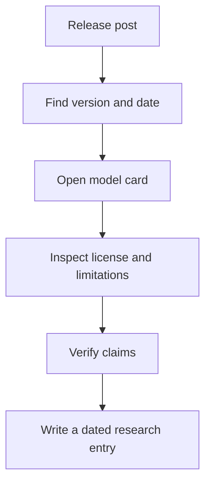

# Day 002 — Reading Model Cards, Changelogs and Licensing

[← Release Season 01](./README.md)

## Lecture

A **model card** summarizes what a specific model was designed for, how it was evaluated, limitations, risks and sometimes training data or hardware requirements. A **changelog** records provider-documented changes, while an **announcement** may describe future rollout plans. They are related but not interchangeable.

### Six reading questions

1. What exact version was released or updated?
2. What is the **announcement date** and what is the **actual availability date**?
3. Is it accessed through a consumer app, API, or downloadable weights?
4. Which benchmarks were run, and by whom?
5. What license, region restrictions or resource requirements apply?
6. Which safety limitations and unresolved questions did the publisher disclose?

## Lab

Use a real [Hugging Face model card guide](https://huggingface.co/docs/hub/model-cards), then open one official model card and fill out a 6-row evidence table. Do not use fabricated benchmark numbers.

[Hugging Face platform handbook](../../PLATFORMS/HUGGING-FACE/README.md)
