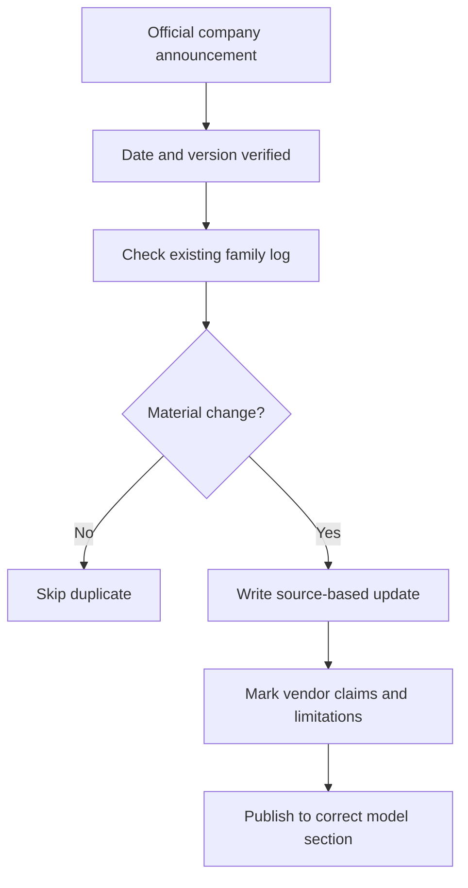

# Day 003 — Research and Verify AI Model Updates

[← Release Season 01](./README.md) · [AI News](../../NEWS/README.md)

## Lecture

A newly publicized AI capability should be reported as one of **confirmed release**, **limited rollout**, **vendor claim**, **independent test** or **future plan**. Avoid mixing these categories or publishing a model comparison without an identical evaluation method.

## Publication workflow

## Practice

Read an entry in the [dated Academy news desk](../../NEWS/README.md). Identify the company, event date, source date, claimed improvements, rollout status and one independent check you would need before recommending the model to a developer.

**Homework:** Produce a 200-word memo and cite two original sources where available; do not invent independent benchmarks.

**Official technical reading:** [Hugging Face Model Cards](https://huggingface.co/docs/hub/model-cards) · [NIST AI Risk Management Framework](https://www.nist.gov/itl/ai-risk-management-framework)
