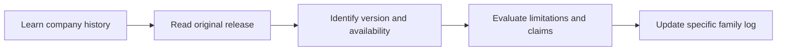

# 📰 Season 01 — Understanding AI Model Updates

**Model research & release literacy · Beginner to intermediate**

[← Model Research](../README.md) · [AI Academy](../../README.md)

| Day | Reading | Outcome |
|---|---|---|
| **001** | [Company history vs product and model](./DAY-001-COMPANY-AND-MODEL.md) | Distinguish founder/company/app/model |
| **002** | [Model cards and release notes](./DAY-002-MODEL-CARDS.md) | Identify what changed in a release |
| **003** | [Compare new model releases responsibly](./DAY-003-RELEASE-VERIFICATION.md) | Avoid fake rankings, dates and marketing claims |

## Follow the specific company

[15 model research folders with update logs](../README.md) contain news concerning *that named model family*. New versions should appear there rather than being added as unrelated beginner lessons.

[← Model Research](../README.md)
