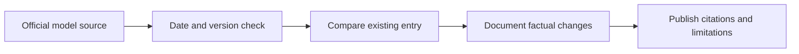

# 📰 Perplexity Sonar — Release and Update Log

**Organization:** Perplexity AI · **Log opened 9 November 2026**

[← Perplexity Sonar research](./README.md) · [AI News Hub](../../NEWS/README.md)

## Historical baseline

Sonar became a branded search-grounded API model family in 2025. This is a historical overview, **not a newly announced release**. For updates, consult [official provider documentation](https://docs.perplexity.ai/).

## New release log

| Release date | Model/version | What changed | Source |
|---|---|---|---|
| — | _No newly reviewed version in this section yet_ | Update only after official date and evidence are confirmed | [Official updates](https://docs.perplexity.ai/) |

Keep company product announcements separate from independent evaluation claims. Model weights, subscriptions, APIs and geographical availability may differ.

[← Model Research](./README.md)
