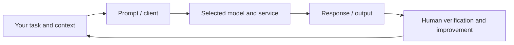

# 🤖 GPT / ChatGPT — AI Family Study Profile

**Developer:** OpenAI · **Origins:** 2022 (ChatGPT product); GPT models predate it · **Profile reviewed:** 9 November 2026

[← 15-model catalog](../MODEL-CATALOG.md) · [← AI Academy](../README.md)

> **Important distinction:** General-purpose proprietary GPT model family and a chat product. A consumer chatbot, underlying model, API and open-weight distribution are not necessarily the same product. Avoid comparing model families by marketing claims alone.

## 1. Where this AI came from

ChatGPT publicly launched in November 2022, building on prior GPT research. Later GPT families expanded multimodal and tool-driven workflows. [Official background](https://openai.com/index/chatgpt/).

## 2. What it does

**Typical applications:** Learning, coding, writing, multimodal analysis and authorized tool use.

**Current research note:** GPT-6 family is current in 2026; products, subscriptions and API model names differ. This page summarizes a model **family**; it does not claim a single version is universally best or list unsupported prices and benchmark rankings.

## 3. How a learner can use or investigate it

1. Open the [official entry point](https://chatgpt.com/) and check account requirements and access in your region.
2. Start with a **non-confidential** task, using a clear objective and an example.
3. Request a structured answer, assumptions, source links where available and uncertainty.
4. Check important claims against original sources; run code before trusting it.
5. Compare the result on the same task with another model family in the catalog.

**Lab exercise:** Ask ChatGPT to explain a JavaScript `if` statement, provide a working example, then quiz you. Verify the example by running it.

## 4. Technical questions

- Is the selected version proprietary, open-weight, or under a specific custom license?
- Is the model served online or deployable locally? What hardware and storage are required?
- Which modalities and tools does the **specific version** accept?
- What data retention, training-use, privacy and organizational settings apply?
- How are answers evaluated for factual accuracy, bias, reliability, latency and cost?

## 5. Simple architecture

## 6. Source links and future updates

- **Official product/site:** https://chatgpt.com/
- **Origin/background:** https://openai.com/index/chatgpt/
- **Release notes, cards or documentation:** https://openai.com/news/

**Learning disclaimer:** Model names, availability, features, prices and default versions can change. Always check the source's own dated release notes. Product experiments should not involve real client files without approval.

### Check your understanding

1. What distinguishes the product name from its underlying model family?
2. Name two suitable applications and one unsafe assumption.
3. What would you verify before using this family for a business project?

[← AI Academy](../README.md) · [Prompt engineering](../SEASON-03/PROMPT-ENGINEERING.md)
