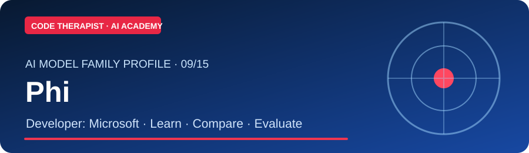
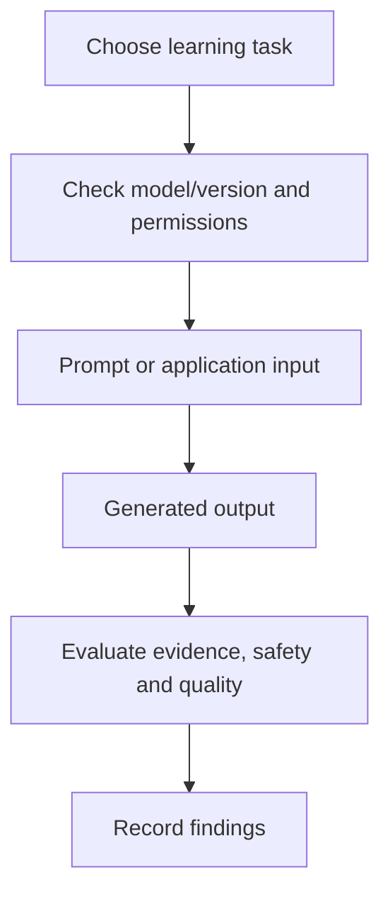

# 🤖 Phi — AI Model Family Guide

**Developer:** Microsoft · **Origin or notable introduction:** 2023 · **Reviewed:** 9 November 2026

[← 15-model catalog](../MODEL-CATALOG.md) · [← AI Academy](../README.md)

## 1. History and background

Efficient small language models designed for constrained computing and research. This profile describes the family and its historical trajectory rather than asserting that a particular named model is the latest or available to everyone. [Learn from the provider](https://www.microsoft.com/en-us/research/project/phi/).

## 2. What students should learn

- Core ideas: AI app versus model family; model card; hardware constraints.
- Distinguish the model weights, API, consumer chat product and any surrounding infrastructure.
- Research intended use, access requirements, modality support, pricing and limitations of a **specific version** before adopting it.
- Evaluate accuracy with a held-out example, not just marketing benchmarks.

## 3. Guided classroom practical

Compare small-model parameter counts, memory requirements and evaluation limits.

**Step 1:** Read the provider's official [model information](https://www.microsoft.com/en-us/research/project/phi/) and release/documentation [index](https://huggingface.co/microsoft).

**Step 2:** Define a harmless sample task, your expected result and how to test it.

**Step 3:** Run the experiment where accessible or plan it as an offline research exercise.

**Step 4:** Record what was correct, unsupported or unclear; revise your evaluation.

## 4. Model-use workflow

## 5. Discussion and assessment

1. What is this model family intended to do?
2. Is your chosen variant hosted, downloadable or subject to a custom license?
3. Which safeguards would be required for use with real client records?
4. What kind of source, benchmark or practical test would substantiate a performance claim?

## Official source links

- [Provider background](https://www.microsoft.com/en-us/research/project/phi/)
- [Model documentation and updates](https://huggingface.co/microsoft)

> **Verification note:** The exact model version, rates, terms and availability may change. Always consult the provider's dated documentation. Do not upload sensitive files to third-party systems without permission.

[← AI Academy](../README.md)
