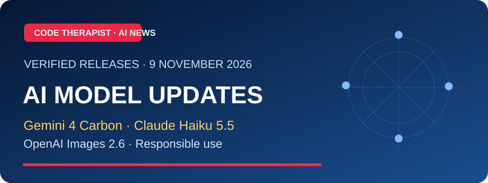
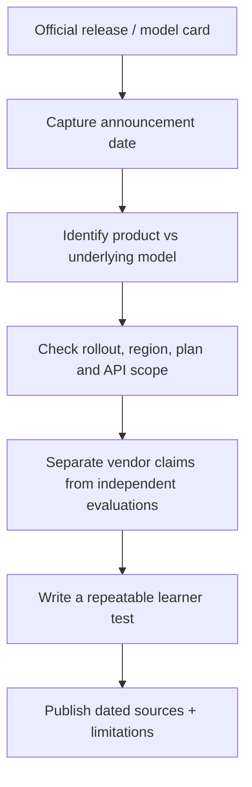

# 📰 AI Release Watch — 9 November 2026

### Gemini 4 Carbon · Claude Haiku 5.5 · OpenAI Images 2.6

**Research review date:** 9 November 2026 · [AI Academy](../README.md) · [15-model catalog](../MODEL-CATALOG.md)

> [!IMPORTANT]
> These are **dated official vendor announcements**, not a performance ranking or independent laboratory benchmark. Launch dates, general accessibility and actual model availability may differ. Quoted speeds or benchmark improvements belong to their respective vendors.

## At a glance

| Release announcement | Announced | What's new | Access caveat | Original source |
|---|---|---|---|---|
| **Gemini 4 Carbon (Google DeepMind)** | **28 Oct 2026** | Frontier model targeting long-horizon engineering and cybersecurity tasks; Google reports significant security benchmark results | Initially a limited cohort of approved cyber defenders and trusted partners, **not a general consumer rollout** | [Google official announcement](https://blog.google/innovation-and-ai/models-and-research/gemini-models/introducing-gemini-4-carbon/) |
| **Claude Haiku 5.5 (Anthropic)** | **7 Oct 2026** | Small/fast Claude model for high-volume summaries, classification, subagent and responsive use | Product/API access and costs vary; vendor speed/cost figures are not our measurements | [Anthropic official release](https://www.anthropic.com/claude-haiku-5-5) |
| **Images 2.6 (OpenAI)** | **4 Nov 2026** | Image editing, consistency improvements, GIF creation and API controls, including specialized Flare/Sunburst variants | Image-generation product family, **not a text-only GPT conversational model**; feature availability may vary | [OpenAI official release](https://openai.com/index/introducing-images-2-6/) |

## 01 · Gemini 4 Carbon — defensive AI under controlled access

Google introduced Gemini 4 Carbon on **28 October 2026** and described it as a frontier model optimized for difficult coding, long-horizon workflows and cybersecurity defense. The company reports strong performance on evaluations involving vulnerabilities and patching. However, at announcement, access was initially limited to selected cybersecurity defenders and trusted partners while broader release remained planned.

**For learners:** The useful topic is *responsible capability evaluation*: Why do security benchmarks matter? Can vendor results generalize to your own systems? What guardrails and authorization are needed?

**Try:** Draft a fictional test matrix with three criteria—code correctness, permission boundaries and documented evidence—without attempting unauthorized vulnerability discovery.

## 02 · Claude Haiku 5.5 — choosing a smaller model

Anthropic's **7 October 2026** announcement emphasizes faster and lower-cost high-volume tasks such as summarization and classification. A small model may be attractive when latency and operating costs matter, but task difficulty, privacy, reliability and access limits still require evaluation.

**Try:** Construct five fictional customer-service questions, define answer expectations, and record correctness, clarity and time to answer for an available model. Never compare costs without recording the exact pricing date and workload.

## 03 · OpenAI Images 2.6 — visual generation and editing

OpenAI announced **Images 2.6** on **4 November 2026**, describing improved image-editing control and GIF workflows. The API includes **GPT-Image-2.6 Flare** and **Sunburst**, with tradeoffs involving speed, quality and controls.

**Try:** With an image you own, specify one small edit, preserve the original, then assess whether the edited output kept the required objects and text. Document unwanted changes. Do not assume visual generation produces valid source-code SVG or an editable layered design unless you actually obtain those formats.

## 🧭 How AI release verification works

## Course assignment — 20 marks

Choose one announcement and answer:

1. Name the announcing organization, release date, and **exact model/product** (4 marks).
2. Explain two real use cases without claiming they are independently tested (4).
3. Identify the access conditions or unknowns (4).
4. Create a harmless five-case evaluation and state what you would measure (5).
5. Cite the original company source and your research date (3).

## Keep the distinction clear

A **model family** (e.g., GPT, Claude, Gemini), a **specific model release** (e.g., Haiku 5.5 or Carbon), an **app** (e.g., ChatGPT), and an **image generation system** (Images 2.6) are not interchangeable. The Academy's [15 profiles](../MODEL-CATALOG.md) describe families and point users toward current dated releases.

## Verified original sources

- [Google DeepMind: Introducing Gemini 4 Carbon, 28 October 2026](https://blog.google/innovation-and-ai/models-and-research/gemini-models/introducing-gemini-4-carbon/)
- [Anthropic: Introducing Claude Haiku 5.5, 7 October 2026](https://www.anthropic.com/claude-haiku-5-5)
- [OpenAI: Introducing Images 2.6, 4 November 2026](https://openai.com/index/introducing-images-2-6/)
- [OpenAI product and API release notes](https://openai.com/products/release-notes/)

**Editorial standard:** Before adding a subsequent update, check if a newer official model card exists, whether the new claim materially changes the teaching content, and whether the story is already in the dated digest. Do not recycle unchanged announcements as breaking news.

[← Academy news index](./README.md) · [← AI Academy](../README.md)
