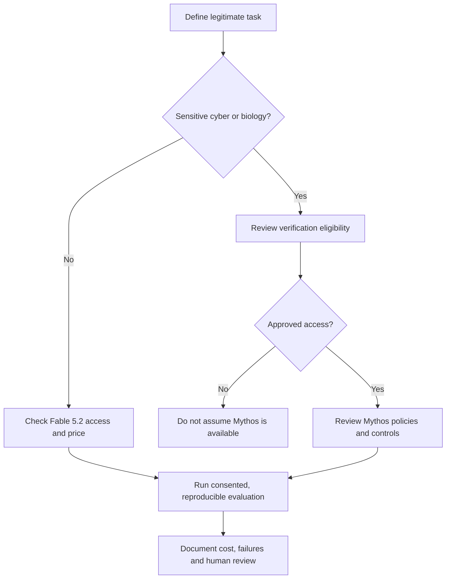

# Claude Fable 5.2 and Mythos 5.2 — official release research

**Announcement:** 9 November 2026 · **Editorial review:** 10 November 2026 · **Status:** Official provider announcement; not independently benchmarked by Code Therapist.

[← Claude updates](../MODEL-RESEARCH/CLAUDE/UPDATES.md) · [← AI news](./README.md)

## What actually changed

Anthropic announced **Claude Fable 5.2** and **Claude Mythos 5.2** on 9 November 2026. Anthropic describes them as the **same underlying model**, exposed with different cybersecurity and biology safeguards and access policies. These are model offerings, not a new independent company or a renamed ChatGPT product.

- **Fable 5.2:** Anthropic says it is available on Claude platforms, including cloud partners, with developer identifier `claude-fable-5-2`. Actual eligibility and plan limits vary.
- **Mythos 5.2:** Access to sensitive cybersecurity and life-sciences use cases is restricted through Anthropic verification programs; do not equate its access with Fable's.
- **Published standard API pricing:** Anthropic lists **US$8 / million input tokens** and **US$40 / million output tokens**. Optional fast mode is listed at **US$16 / million input** and **US$80 / million output**; verify the applicable platform and any additional fees before procurement.
- **Performance:** Anthropic reports up to **30% faster output** compared with Fable/Mythos 5.1, and claims improvements in coding, science and vision. These are vendor statements and context-dependent results, not Code Therapist measurements.
- **Safety:** Anthropic reports expanded prerelease testing, including behavioral audits and safeguards. Its stated assessment is not proof of zero risk. Read the linked system card and external evaluator summaries before high-stakes use.

## Access decision diagram

## Research exercise

For a fictional university IT helpdesk, draft **five non-sensitive support prompts** and a scoring rubric for accuracy, unsupported claims, cost and response time. Compare documented provider claims with actual results only if you have authorized access and record model ID, settings, run date and sample size. **Do not invent scores.** Write down what cannot be established from a press release.

## Quiz

1. Why are Fable and Mythos distinct offerings if Anthropic says they share an underlying model?
2. How is API token pricing different from a consumer subscription?
3. Why does a vendor benchmark not establish independent superiority?
4. What evidence would you require before deployment in a Ugandan business?

## Primary evidence

- [Anthropic official release — 9 November 2026](https://www.anthropic.com/claude-fable-and-mythos-5-2)
- [Anthropic dated model announcements](https://www.anthropic.com/news/models)

**Limitations:** No direct model tests, independent performance verification or region-specific checkout performed. Availability and pricing can change; consult current provider terms.
