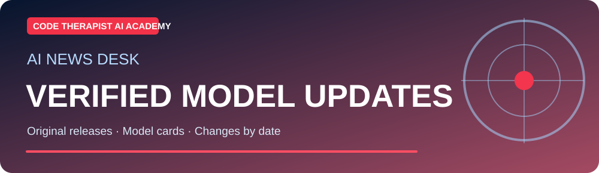
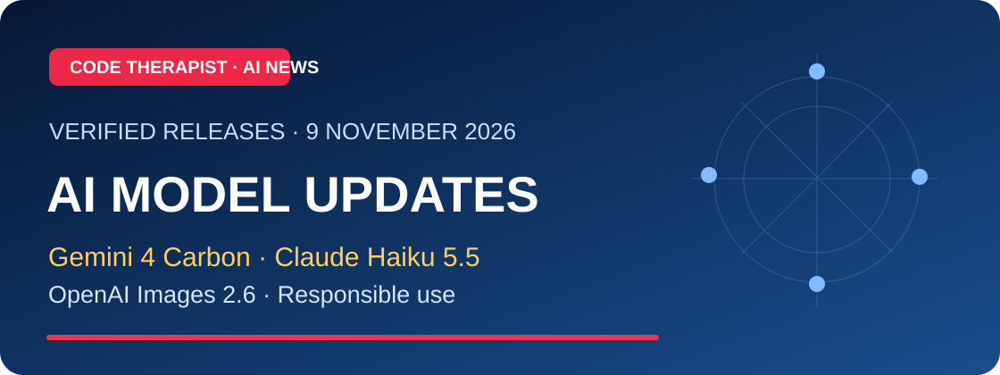
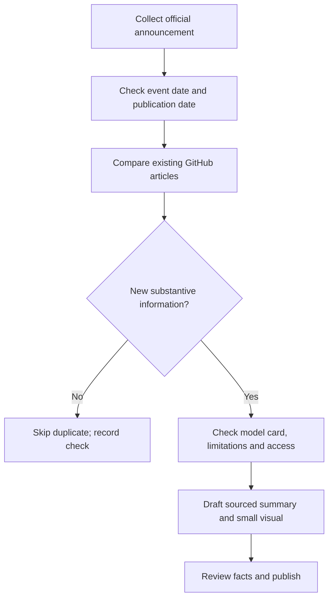

# 📰 AI Models & Automation — Verified Update Desk

**Editorial review:** Monday, **9 November 2026** · [AI Academy](../README.md) · [15 Model Families](../MODEL-CATALOG.md)

> This is a **dated research digest**, not a live news feed. Every entry records a primary source and clearly distinguishes manufacturer claims, model cards, commercial availability and independently tested performance. Future daily checks should avoid reposting unchanged stories.

## 🆕 Featured research — 9 November 2026

**[Read the verified AI releases and classroom exercises](./2026-11-09-MODEL-RELEASE-WATCH.md)** — Google Gemini 4 Carbon (28 October), Anthropic Claude Haiku 5.5 (7 October), and OpenAI Images 2.6 (4 November). Official sources, access limits and an original learning assignment included.

## Notable verified updates

| Date of release/card | AI family | What changed | Official source |
|---|---|---|---|
| **5 Nov 2026** | **Google Gemini** | DeepMind published the **Gemini Omni 1.2 Flash model card**, describing text/image/audio/video inputs and video-with-audio output, its intended use and safety limitations. This is a model-card claim, not our own testing. | [Google DeepMind model card](https://deepmind.google/models/model-cards/gemini-omni-1-2-flash/) |
| **29 Sep 2026** | **OpenAI GPT** | OpenAI documented **GPT-6.1 Sol** in its API release notes, including updates for coding/professional use and model/API availability. Plan access is separate. | [OpenAI API changelog](https://developers.openai.com/api/docs/changelog) |
| **10 Sep 2026** | **DeepSeek** | DeepSeek released **V4.1 Flash**, describing visual inputs, updated architecture and API routing. Reported benchmark figures are vendor results. | [DeepSeek developer changelog](https://api-docs.deepseek.com/updates/) |
| **2026 model index** | **IBM Granite** | IBM's model selector lists **Granite 4.2** sizes, weights, license terms and estimated hardware requirements; consult the exact chosen variant. | [IBM Granite model selector](https://www.ibm.com/granite/playground/model-selector/models) |

## News verification workflow

## Standard AI-news article fields

1. **Clear headline and a 16:9 landscape cover**.
2. **Announcement date vs rollout date**.
3. **Who announced it** and direct company source.
4. **What changed** versus the previous version, when documented.
5. **Who can use it** and any country, plan or API limitations.
6. **Risks and unresolved claims**.
7. **Original comparison, architecture diagram or example**, if helpful.
8. **Last-checked date**, corrections and original links.

## Study assignment

Select one entry. Read the official card/changelog. Write 150 words describing **what was actually released**, **what is merely claimed** and **what evidence you would need before recommending it for a Ugandan organization**.

[← Academy](../README.md) · [AI News library](../../AI-NEWS/README.md)
