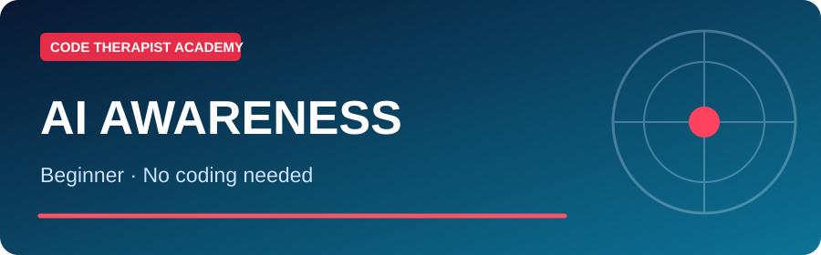
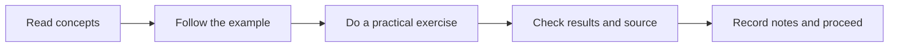

# 🎓 AI Literacy — Understand Without Coding

**Level:** Awareness · **Season 01 — First Contact with AI** · **3 starting daily lessons published 9 November 2026**

[← Academy](../README.md) · [Model research desk](../MODELS/README.md) · [Hugging Face](../PLATFORMS/HUGGING-FACE/README.md)

> For people who want to understand what AI is, what it can do, where it is useful and what its risks are.

## Season 01 · Day-by-day classes

| Day | Lecture and learning activity | Status |
|---|---|---|
| 001 | **[Day 001 — What AI Actually Is](./SEASON-01/DAY-001-WHAT-IS-AI.md)** | Full lesson published |
| 002 | **[Day 002 — AI in Everyday Life](./SEASON-01/DAY-002-EVERYDAY-AI.md)** | Full lesson published |
| 003 | **[Day 003 — Can We Trust AI?](./SEASON-01/DAY-003-TRUST-AND-SAFETY.md)** | Full lesson published |

## Study framework

**Learner evidence:** 5–10 sentences of understanding, a screenshot or small project where relevant, and two questions for the next class. Do not record fictitious results or upload personal identifiers.

## Later season progression

**[Season 02 — Intermediate](./SEASON-02/README.md):** Day 001 is available as a complete starter lecture and practical. **[Season 03 — Advanced or capstone](./SEASON-03/README.md):** Day 001 is available as a complete starter lesson. Additional days are to be published progressively; these seasons are not yet fully populated.

## Exit questions

What can you now explain without looking at notes? What did you verify using a primary source? What evidence would show you are ready for the next season?

[← AI Academy](../README.md)
