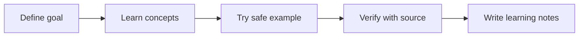

# Day 003 — AI for Research, Writing and Study

**Practical AI User — Prompt and Produce · Season 01 — Use AI Responsibly · Hands-on / no coding prerequisite**

[← Pathway](../README.md) · [AI Academy](../../README.md)

## 🎯 Lesson objective

Use AI to organize public research, outline work and generate revision questions—but do not rely on invented citations, confidential uploads or unverified outputs.

## 📖 What to learn

1. Define the key terms before using an AI service or coding environment.
2. Explain where this technique is useful and when it may be unsuitable.
3. Identify the inputs, outputs, data ownership and accuracy limitations.
4. Use primary documentation and document what the source actually supports.

## 🧭 Learning flow

## 🧪 Today's practical class

Ask a tool to summarize an official public article. Open each supplied citation, check that it actually supports the corresponding claim, and prepare a 100-word sourced summary.

### Study exercise — 20 minutes

- **5 min:** Read the lecture and official reference.
- **10 min:** Complete the example using fictional or authorized data.
- **5 min:** Write what worked, what failed, and which assumption remains untested.

## ✅ Day quiz

1. What is the main concept in today's lesson?
2. Describe a real-world use that does not require sharing private data.
3. Name a failure or misuse scenario and a way to detect it.
4. What is one statement from the official source that you can verify?

**Assessment rubric:** explanation (3), practical evidence (3), source check (2), safety/limitations (2) = 10 marks.

## 📚 Official course material

- [Microsoft Generative AI for Beginners](https://microsoft.github.io/generative-ai-for-beginners/)
- [Google Machine Learning education](https://developers.google.com/machine-learning)

> **Publication note:** This is a full starting lesson; later days and seasons will be added as actual content becomes available. Never claim that a user completed the practical before observing their work.

[← Pathway index](../README.md)
