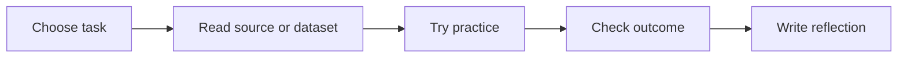

# Day 001 — Design a Reusable Prompt Library

**Practical AI User · Season 03 — Productivity Portfolio** · Published 9 November 2026

[← Season 03 — Productivity Portfolio](./README.md) · [Learning pathway](../README.md)

## Lecture

Create three prompts for learning, writing and summarizing; give each an expected output, test input, safety note and verification rubric. Separate the stated objective, the inputs, an observable result and what would count as failure. A confident model response or an attractive user interface alone does not establish quality.

## Learning workflow

## Today's assessment

1. State the practical objective in one sentence.
2. Complete the exercise using **public or synthetic information**.
3. Record one success and one limitation, supported by evidence.
4. Identify a privacy or reliability concern and its mitigation.

**Assessment: 10 marks** (concept 3, evidence 3, safety 2, reflection 2).

**Further learning:** [Google Machine Learning Crash Course](https://developers.google.com/machine-learning/crash-course) · [Microsoft Generative AI for Beginners](https://microsoft.github.io/generative-ai-for-beginners/)

[← Track](../README.md)
