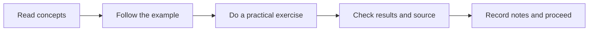

# 🎓 AI / Machine Learning Builder — Train and Deploy

**Level:** Technical · **Season 01 — Foundations of Building AI** · **3 starting daily lessons published 9 November 2026**

[← Academy](../README.md) · [Model research desk](../MODELS/README.md) · [Hugging Face](../PLATFORMS/HUGGING-FACE/README.md)

> For learners who want Python, data science, model training, LLMs, fine-tuning, evaluation and deployment.

## Season 01 · Day-by-day classes

| Day | Lecture and learning activity | Status |
|---|---|---|
| 001 | **[Day 001 — Python, Data and Learning Objectives](./SEASON-01/DAY-001-PYTHON-DATA.md)** | Full lesson published |
| 002 | **[Day 002 — Train a First Classifier](./SEASON-01/DAY-002-FIRST-CLASSIFIER.md)** | Full lesson published |
| 003 | **[Day 003 — Find and Evaluate Models on Hugging Face](./SEASON-01/DAY-003-HUGGING-FACE-MODELS.md)** | Full lesson published |

## Study framework

**Learner evidence:** 5–10 sentences of understanding, a screenshot or small project where relevant, and two questions for the next class. Do not record fictitious results or upload personal identifiers.

## Later season progression

**Season 02 (curriculum planned):** build on the first three days with deeper exercises and independent source-reading. **Season 03 (curriculum planned):** complete a portfolio project or knowledge presentation. These later seasons are **not yet published lessons** and should not be represented as complete.

## Exit questions

What can you now explain without looking at notes? What did you verify using a primary source? What evidence would show you are ready for the next season?

[← AI Academy](../README.md)
