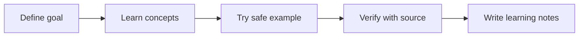

# Day 002 — Train a First Classifier

**AI / Machine Learning Builder — Train and Deploy · Season 01 — Foundations of Building AI · Technical**

[← Pathway](../README.md) · [AI Academy](../../README.md)

## 🎯 Lesson objective

Learn features, labels, train/test split, fitting, prediction and errors. Separate held-out test data so the model cannot simply memorize the answers.

## 📖 What to learn

1. Define the key terms before using an AI service or coding environment.
2. Explain where this technique is useful and when it may be unsuitable.
3. Identify the inputs, outputs, data ownership and accuracy limitations.
4. Use primary documentation and document what the source actually supports.

## 🧭 Learning flow

## 🧪 Today's practical class

Run the official scikit-learn Iris classification example or use the built-in Iris dataset. Split train/test, fit a simple classifier, report accuracy and at least one limitation. Do not fabricate performance figures.

### Study exercise — 20 minutes

- **5 min:** Read the lecture and official reference.
- **10 min:** Complete the example using fictional or authorized data.
- **5 min:** Write what worked, what failed, and which assumption remains untested.

## ✅ Day quiz

1. What is the main concept in today's lesson?
2. Describe a real-world use that does not require sharing private data.
3. Name a failure or misuse scenario and a way to detect it.
4. What is one statement from the official source that you can verify?

**Assessment rubric:** explanation (3), practical evidence (3), source check (2), safety/limitations (2) = 10 marks.

## 📚 Official course material

- [scikit-learn supervised learning](https://scikit-learn.org/stable/supervised_learning.html)
- [Google Machine Learning education](https://developers.google.com/machine-learning)

> **Publication note:** This is a full starting lesson; later days and seasons will be added as actual content becomes available. Never claim that a user completed the practical before observing their work.

[← Pathway index](../README.md)
