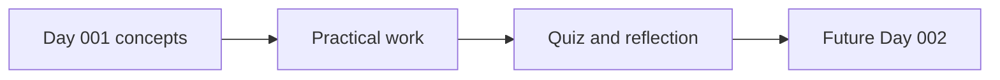

# 🎓 AI / Machine Learning Builder — Season 03 — Fine-Tuning and Deployment

**Season 3 · First published learning day**

[← Track overview](../README.md) · [AI Academy](../../README.md)

| Day | Lesson | Status |
|---|---|---|
| 001 | [Day 001 — Build a Deployment Decision Document](./DAY-001.md) | Complete starter lecture and practical |

**Remaining days:** curriculum expansion is planned, but not yet published. Later materials should preserve sequential day numbering and genuine assessment evidence.

[← Track overview](../README.md)
