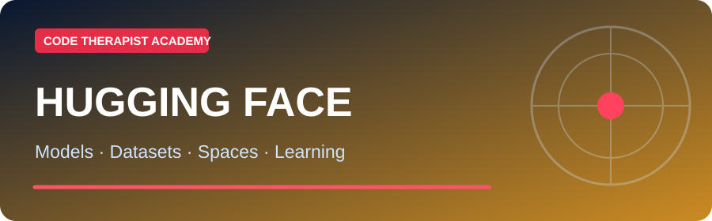
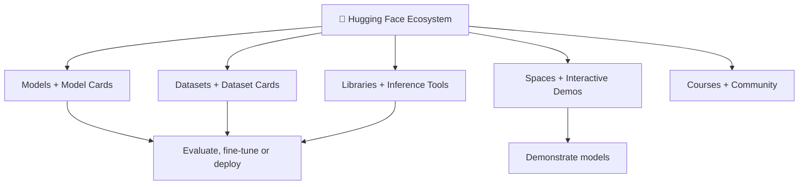
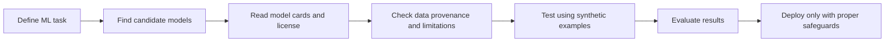
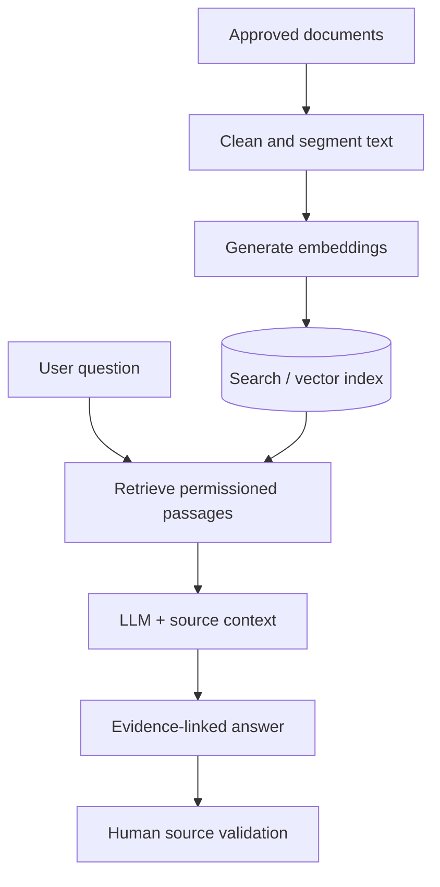

# 🤗 Hugging Face — Platform, Knowledge Hub and AI Development Guide

**Code Therapist AI Academy · Platform research · Updated 10 November 2026**

[← Academy](../../README.md) · [ML Builder pathway](../../PATH-03-ML-BUILDER/README.md) · [AI Model Families](../../MODEL-CATALOG.md)

> Hugging Face is **not one LLM**. It is a platform and ecosystem of model repositories, datasets, demonstration apps, learning courses and development libraries. Model repositories may come from many organizations with different licenses, risks and quality.

## 📚 Structured Hugging Face lessons — Season 01

**[Start the first four day-by-day classes →](./SEASON-01/README.md)**

| Day | Original classroom lesson | Key learning outcome |
|---:|---|---|
| **001** | [What Is Hugging Face?](./SEASON-01/DAY-001-PLATFORM-INTRODUCTION.md) | Models, datasets, Spaces, collaboration |
| **002** | [Read a Model Card](./SEASON-01/DAY-002-MODEL-CARDS.md) | Publisher, license, intended use and limits |
| **003** | [Knowledge Bases and RAG](./SEASON-01/DAY-003-DATASETS-AND-RAG.md) | Dataset vs retrieval index vs model-generated answer |
| **004** | [Spaces: Safe AI Demos](./SEASON-01/DAY-004-SPACES-SAFE-DEMOS.md) | SDKs, visibility, credentials and compute access |

These four classes are fully written with original explanations, Mermaid diagrams, safe practical tasks and checkpoint questions. Later lessons on inference and fine-tuning are not yet marked complete.

## 01 · What is Hugging Face?

[Hugging Face](https://huggingface.co/) is a collaborative machine-learning platform. Its **Hub** supports Git-like versioned repositories for models, datasets and Spaces demos. Teams can browse hosted artifacts, publish work, maintain model cards and select access levels. It also provides libraries that help with training, evaluation and deployment. See [official Hub documentation](https://huggingface.co/docs/hub/main/index).

### Landscape of the platform

## 02 · Major areas to explore

| Area | Purpose | Official link |
|---|---|---|
| **Models** | Find language, vision, speech and multimodal model repositories | [Browse Models](https://huggingface.co/models) |
| **Model cards** | Read intended use, license, training details, risks and evaluation | [Model Card Guide](https://huggingface.co/docs/hub/model-cards) |
| **Datasets** | Find reusable datasets and dataset documentation | [Browse Datasets](https://huggingface.co/datasets) |
| **Dataset cards** | Investigate collection method, bias, consent, scope and limitations | [Dataset Card Guide](https://huggingface.co/docs/hub/datasets-cards) |
| **Spaces** | Explore or create browser-accessible demos | [Browse Spaces](https://huggingface.co/spaces) |
| **Transformers** | Load/use compatible pretrained models with Python | [Transformers Docs](https://huggingface.co/docs/transformers/index) |
| **Datasets library** | Load/process datasets for ML work | [Datasets Docs](https://huggingface.co/docs/datasets/index) |
| **PEFT** | Parameter-efficient fine-tuning approaches | [PEFT Docs](https://huggingface.co/docs/peft/index) |
| **Inference Providers** | Run supported hosted models via a service | [Inference Docs](https://huggingface.co/docs/inference-providers/index) |
| **Courses** | Learn LLM fundamentals and agents with structured lessons | [LLM Course](https://huggingface.co/learn/llm-course/chapter1/1) |

## 03 · Three learner levels

### Level A — Awareness (no coding)

- Explain the difference between a platform, model family, model checkpoint, dataset and interactive Space.
- Browse the Models page and read one model card.
- Inspect a Space without submitting confidential information.

**Day exercise:** choose one public model card and list its creator, task, licensing status and one documented limitation. If a field is missing, write **“not stated”**.

### Level B — Practical user

- Compare two model cards for the **same task**.
- Test a publicly accessible Space on a harmless input.
- Read one dataset card and identify missing or uncertain data provenance.

**Day exercise:** use a text-classification demo or a public test input. Write three observations and describe why a nice demo is not a guarantee of production accuracy.

### Level C — ML developer

- Set up a Python environment with dependencies chosen from the model's official documentation.
- Learn inference, data splits, evaluation, versioning and secure handling of tokens.
- Decide whether training from scratch, fine-tuning or using an existing model is appropriate.
- Evaluate memory requirements and licensing *before downloading* large weights.

**Day exercise:** compare a lightweight model with a larger model card; prepare a resource/accuracy/privacy evaluation table. Run a demo only when your hardware is suitable.

## 04 · How to work with models responsibly

### Model-card reading checklist

- Who published and maintains the model?
- Is the repository authentic and does the license allow your intended use?
- Does the model support your language, task, modality and hardware?
- Which benchmarks are reported, and were they independently reproduced?
- What are the privacy, security, bias and misuse limitations?
- Are there gated access requirements or API costs?

## 05 · Knowledge bases, retrieval and RAG

A *knowledge base* is an organized set of information that an application can search or retrieve. Hugging Face hosts **model and dataset repositories**, but a production **RAG knowledge base** is built separately: documents are processed and indexed, retrieved under access controls and supplied as context to a language model.

**Important:** Putting sensitive documents in a public Hub repository makes them public. A Hugging Face model card is not itself a private document knowledge base, and a citation generated by an LLM does not guarantee correctness.

## 06 · Code Therapist classroom laboratory

**Scenario:** You are building an AI helper for a fictional Ugandan bookshop.

1. Choose between a text classifier and a language model based on the actual problem.
2. Browse two model cards and record developer, license and deployment requirements.
3. Find a permitted dataset or create a small synthetic example.
4. Design five held-out test inputs, including one out-of-scope input.
5. Describe how the model would be integrated with an approved web application.
6. Record expected costs, privacy boundaries and fallback behavior.

**Submission:** 1-page technical decision memo and one flowchart. Do not claim measured accuracy unless you have run the experiment.

## 07 · Trusted training links

- [Official Hugging Face Hub documentation](https://huggingface.co/docs/hub/main/index)
- [The free Hugging Face LLM Course](https://huggingface.co/learn/llm-course/chapter1/1)
- [Hugging Face Agents Course](https://huggingface.co/learn/agents-course/unit0/introduction)
- [Hugging Face documentation index](https://huggingface.co/docs)
- [Hugging Face Spaces overview](https://huggingface.co/docs/hub/spaces-overview)

> **Editorial caution:** Counts of hosted models, datasets and Spaces change frequently. The platform is free to browse and many courses are free, but some inference, hardware, private-space and deployment capabilities can have restrictions or costs. Check current terms before use.

[← AI Academy](../../README.md)
