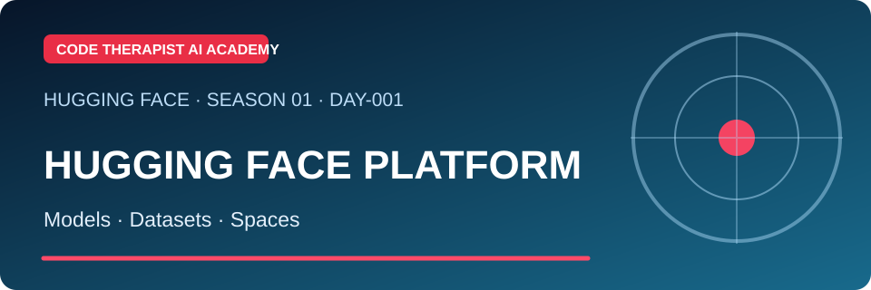
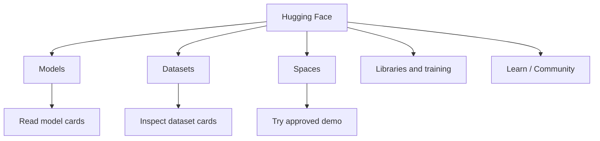

# Day 001 · What Is Hugging Face?

**Level:** Beginner · **Season 01 — Platform and Model Literacy** · **Reviewed:** 9 November 2026

[← Season 01](./README.md) · [Platform overview](../README.md)

## 🎯 Objective

Explain **Hugging Face as a collaboration platform**, rather than confusing it with ChatGPT or treating it as a single AI model.

## 📖 Lecture

Hugging Face provides a Hub where researchers and developers publish and explore model repositories, datasets and interactive demonstration applications called **Spaces**. A hosted repository is not automatically a secure or production-ready AI product. The official Hub documentation explains its versioned collaboration model. [Official Hub guide](https://huggingface.co/docs/hub/main/index).

| Item | Definition | Why it matters |
|---|---|---|
| Model repository | Files, weights, configuration and documentation for a particular model | Lets you evaluate, version or sometimes download a model |
| Model card | Description of purpose, risks, training context and evaluations | Helps determine suitability |
| Dataset repository | Collection of examples, files, metadata and access terms | Supports training, testing or research |
| Space | Interactive model or application demo | Demonstrates a use case; not proof of robustness |
| Library | Software package such as Transformers or Datasets | Helps developers build and evaluate workflows |

## 🧭 Platform map

## 🧪 Lab — 20 minutes (no coding)

1. Open [Hugging Face Models](https://huggingface.co/models) and choose a public, small-scale example.
2. Read the **publisher name**, task tags and model card. Record what you can independently verify.
3. Open [Datasets](https://huggingface.co/datasets) and compare the purpose of a dataset card.
4. Open [Spaces](https://huggingface.co/spaces); observe a demo without submitting private material.
5. Write six sentences distinguishing a model, a dataset and a Space.

**Expected evidence:** A table of three public URLs, item type, creator and one uncertainty per item. Do not invent evaluation scores.

## ✅ Quiz (10 marks)

1. Is Hugging Face itself one chatbot? Explain (2).
2. What does a model repository hold (2)?
3. Why should you read the card before using a model (3)?
4. Name one risk of treating a Space demo as a production service (3).

## 📚 Sources

- [Official Hugging Face Hub documentation](https://huggingface.co/docs/hub/main/index)
- [Models documentation](https://huggingface.co/docs/hub/models)
- [Hugging Face Learn](https://huggingface.co/learn)

[← Course](./README.md) · [Day 002 →](./DAY-002-MODEL-CARDS.md)
