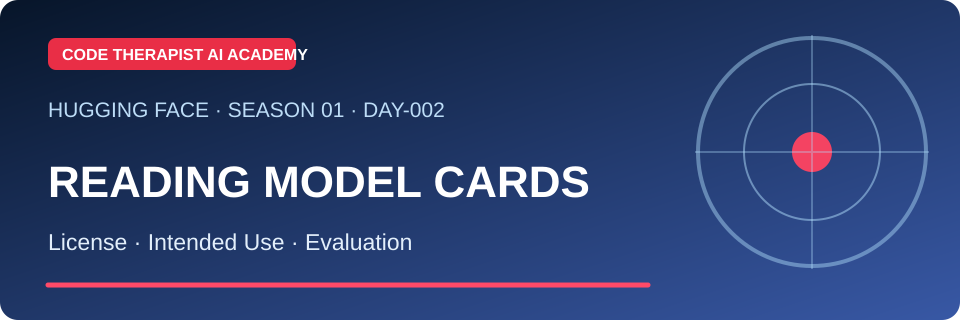
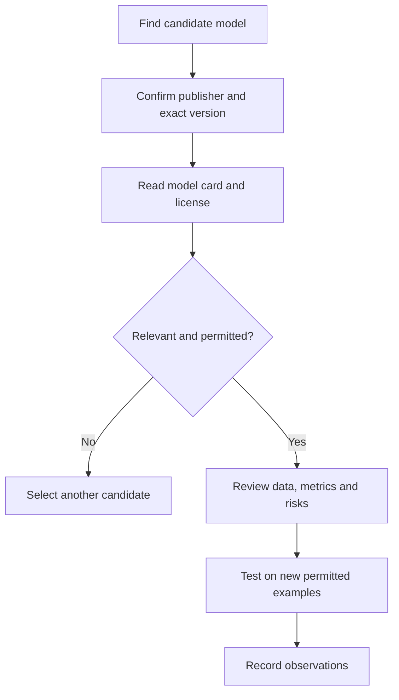

# Day 002 · Understanding Model Cards and Licensing

**Level:** Beginner to Intermediate · **Season 01 — Platform and Model Literacy** · **Reviewed:** 9 November 2026

[← Season 01](./README.md) · [← Day 001](./DAY-001-PLATFORM-INTRODUCTION.md)

## 🎯 Objective

Learn to assess **a specific model version** before testing, fine-tuning, downloading or building with it.

## 📖 Lecture

Hugging Face model cards are typically README-style documentation associated with a particular repository. A good card describes model origin, intended uses, limits, evaluation results and training context; its completeness varies. The official documentation recommends describing biases and ethical considerations, experimental information and training datasets. <https://huggingface.co/docs/hub/model-cards>

**A famous company name or a popular download count is not a safety or accuracy guarantee.**

| Field to inspect | Research question |
|---|---|
| Publisher | Is this an authentic organization or a community fork? |
| Task and modalities | Does it support the exact use case? |
| License | Do the terms permit business or modification? |
| Language | Has the intended language actually been evaluated? |
| Dataset provenance | Was collection permitted and documented? |
| Metrics | Which test datasets and methods support the scores? |
| Limits | What does the publisher say the model should not be used for? |
| Hardware | Can the learner's machine realistically run the version? |

## 🧭 Decision process

## 🧪 Laboratory

Choose **two publicly documented models performing a similar task**. Create the following worksheet:

| Candidate | Provider | Task | License | Reported evaluation | Limitations |
|---|---|---|---|---|---|
| A | To be researched | — | — | — | — |
| B | To be researched | — | — | — | — |

Mark undocumented items as **not stated**, rather than guessing. Do not download large weights just to complete this exercise.

## ✅ Checkpoint questions

1. What is the difference between *open weights* and an unrestricted open-source license?
2. Why is a model name without a precise version insufficient for reproducibility?
3. What would you need to verify before using it on Ugandan customer information?

## 📚 Sources

- [Official model-card reference](https://huggingface.co/docs/hub/model-cards)
- [Official model repository guide](https://huggingface.co/docs/hub/models)

[← Day 001](./DAY-001-PLATFORM-INTRODUCTION.md) · [Day 003 →](./DAY-003-DATASETS-AND-RAG.md)
