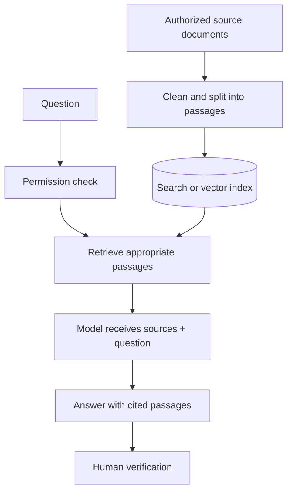

# Day 003 · Datasets, Knowledge Bases and Retrieval-Augmented Generation

**Level:** Practical AI learner · **Season 01 — Platform and Model Literacy** · **Reviewed:** 9 November 2026

[← Season 01](./README.md) · [← Day 002](./DAY-002-MODEL-CARDS.md)

## 🎯 Objective

Separate three concepts that students often mix up: a **dataset**, a **knowledge base** and a **retrieval-augmented generation (RAG) system**.

## 📖 Lecture

A *dataset* is a collection of examples for analysis, training or evaluation. A *knowledge base* organizes information so an application can find facts or documents. A **RAG** application first retrieves relevant, authorized passages from such a collection, then places them into a model's context while answering. The answer is still generated and **must be checked against the retrieved text**.

Hugging Face hosts datasets, models and demos; that does not automatically create a private RAG knowledge base for your organization.

| Concept | What it contains | Common error |
|---|---|---|
| Dataset | Structured or unstructured examples with documentation | Assuming all data is licensed for reuse |
| Knowledge base | Curated facts and documents, possibly indexed | Treating a public repository as private storage |
| Retrieval index | Searchable representation of source passages | Failing to enforce user access permissions |
| RAG pipeline | Retriever + model + context + response | Assuming citations guarantee correctness |

## 🧭 Typical knowledge-base workflow

## 🧪 No-cost classroom practical

Create **three fictional school policy paragraphs** in a local text file. Write three questions and manually highlight which paragraph supports each answer. One question should be unanswerable; the correct behavior is to state that the supplied information does not answer it.

**Next technical level:** Study [Hugging Face's LLM course](https://huggingface.co/learn) and the [Transformers Trainer](https://huggingface.co/docs/transformers/en/trainer). Fine-tuning updates model parameters; RAG typically adds context without retraining the underlying model.

## ✅ Quiz

1. What is the difference between fine-tuning and RAG?
2. Why must a document search enforce permissions?
3. What should an assistant say when the knowledge base contains no answer?

## 📚 Sources

- [Hugging Face Hub datasets](https://huggingface.co/docs/hub/datasets)
- [Hugging Face model-card guidance](https://huggingface.co/docs/hub/model-cards)
- [Transformers fine-tuning documentation](https://huggingface.co/docs/transformers/training)

[← Day 002](./DAY-002-MODEL-CARDS.md) · [← Season](./README.md)
