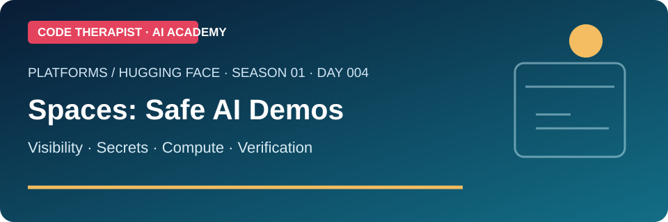
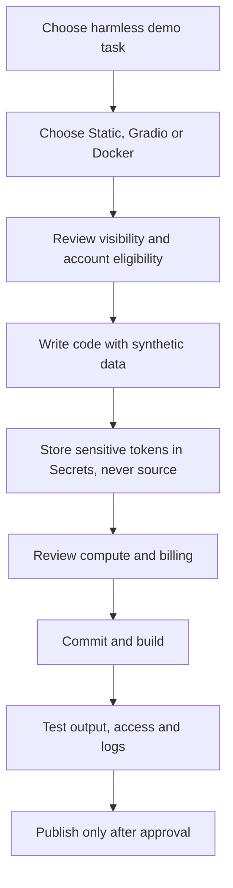

# Day 004 · Hugging Face Spaces: Build and Publish a Safe AI Demo

**Department 03 — AI Platforms** · **Season 01: Platform and Model Literacy** · **Level: Beginner to Practical** · **Published: 10 November 2026** · **Status: Lecture and exercise published; no demo deployment claimed**

[← Season 01](./README.md) · [← Day 003](./DAY-003-DATASETS-AND-RAG.md) · [Platform overview](../README.md)

## Objective

Explain how a **Space** differs from a model repository, select the right visibility and SDK, understand compute costs, and protect credentials before launching a demonstration.

## Lecture

A Hugging Face **Space** is a versioned repository and hosted application environment for an interactive demonstration. It is **not the underlying model**: a Space may call a hosted model or run one locally. The official Spaces guide describes three SDK choices: **Static HTML, Gradio and Docker**. Source files and deployments are connected through Git commits; an updated commit can trigger a rebuild.

**Visibility is not one setting for all risks.** A *public* Space exposes source and app; a *private* Space restricts both; a *protected* Space keeps source private while allowing public app access through an embed or custom URL, subject to eligibility. Check current product terms rather than assuming every option is free.

**Hardware and billing:** Static Spaces are described as free. The current Spaces guide says creating compute-backed Gradio or Docker Spaces generally requires an eligible paid plan, with limited ZeroGPU exceptions. CPU Basic is listed at no hourly hardware cost, but this **does not mean every account can create every kind of Space without a plan**. GPU upgrades and persistence may cost extra.

**Secrets:** Store tokens in Space **Secrets**, not source code or public Variables. Public Variables are not suitable for credentials. A static client-side app cannot safely hide secrets in browser JavaScript. Use an appropriate server-side design for any sensitive calls.

## How a safe demo is released

## Guided practical: a no-secret concept demo

1. Design a **fictional university course finder** using three made-up course titles and descriptions.
2. Choose a **Static HTML Space** if the demo only filters a hard-coded list in the browser; explain why no LLM or GPU is necessary.
3. Draft a `README.md` with purpose, sample inputs, data provenance (synthetic), limitations and privacy note.
4. Create a checklist for public source visibility, mobile layout, keyboard accessibility, and errors.
5. Optional: publish to a personal test Space only after reviewing current access, plan and content rules. **No deployment has been performed for this class.**

**Expected submission:** one-page architecture decision, a visibility/access table and screenshots or a written mockup. If not deployed, label the result **design only**.

## Quiz

1. How does a Space differ from a model checkpoint?
2. What is the difference between public, protected and private visibility?
3. Why should an API token not be stored in a public Variable?
4. Why might a Static Space be preferable to a GPU-backed demo?
5. What must you verify before claiming the application is live?

**Assessment / 10:** concepts (3), visibility and security (3), design exercise (3), sources and limitations (1).

## Official sources (reviewed 10 November 2026)

- [Hugging Face — Spaces overview](https://huggingface.co/docs/hub/spaces-overview)
- [Hugging Face — Managing Spaces and Secrets](https://huggingface.co/docs/huggingface_hub/en/guides/manage-spaces)
- [Hugging Face — Hub documentation](https://huggingface.co/docs/hub/main/index)

**Editorial note:** This lesson reflects documentation observed on 10 November 2026, not a claim of a newly launched Hugging Face product. Recheck plan eligibility, costs and restrictions before deployment.
