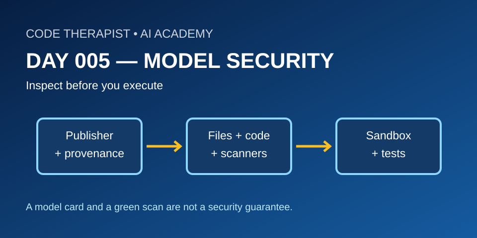
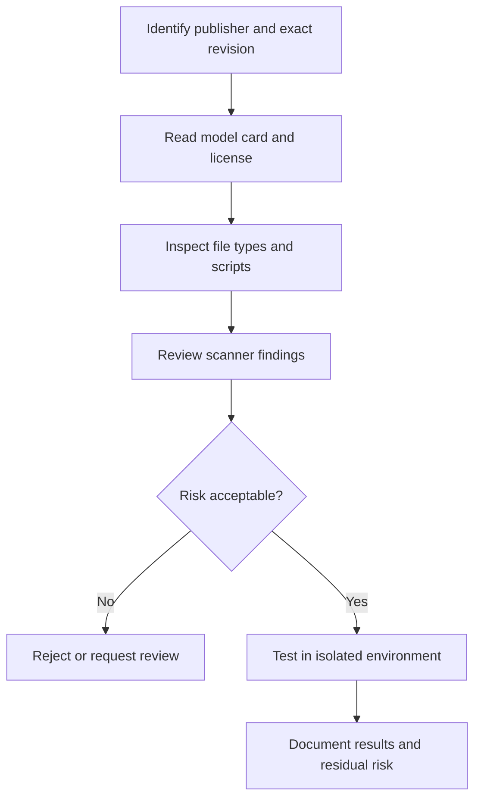

# Day 005 · Model Repository Security: Inspect Before You Run
**Department 03 — Platforms / Hugging Face** · **Season 01** · **11 November 2026** · **Status: lesson published; no external model executed**
[← Season](./README.md) · [← Day 004](./DAY-004-SPACES-SAFE-DEMOS.md)

## Learning outcomes
Identify the difference between a reputable publisher, a documented model card, a file scan and a reproducible security review. Recognize why loading an untrusted checkpoint or enabling remote model code can be risky.

## Lecture
A Hugging Face repository can contain model weights, configuration, scripts and documentation. Its model card explains intended use and limitations, but **does not certify that every file is safe**. First confirm the publisher's identity, license, exact revision and whether the model is gated. A familiar model name alone is not proof of provenance.

### File formats and code execution
Python's pickle deserialization can execute code. Model files such as certain `.bin` or `.pt` checkpoints may involve pickle; the safer `safetensors` format is designed to store tensor data without arbitrary pickle execution. **A safetensors file does not make an entire repository or its dependencies trustworthy.** Inspect accompanying scripts, custom loaders and dependency versions. Avoid `trust_remote_code=True` unless the code has been independently reviewed and execution is isolated.

### Scanners and limits
Hugging Face documents malware, pickle and third-party scanning on the Hub. Scanner warnings deserve investigation, but a clean result is **not a guarantee**: scanners can miss malicious behavior or risks in dependencies. Prefer pinning an audited commit, least-privilege tokens, isolated environments, limited network access and synthetic test data. Do not execute unfamiliar downloaded artifacts on a production computer.

## Review workflow

## Guided practice — paper-only security review
A fictional model repository named `campus-helper-7b` has an anonymous publisher, a sparse model card, `weights.bin`, and a Python loader requiring custom remote code. No scanner warning is visible.

1. List five questions to ask before downloading it.
2. Explain why no warning does **not** prove safety.
3. Describe a safer alternative: verified publisher, documented license, reviewed code and preferably safetensors weights.
4. Sketch an isolated test environment with no real student records or production credentials.
5. Write a **go / no-go** decision with at least two unresolved risks.

**Submission:** one-page risk assessment; no actual model execution required.

## Quiz
1. What is pickle deserialization risk?
2. Does a model card certify security?
3. What does safetensors protect against, and what does it not protect against?
4. Why pin a specific commit?
5. What is wrong with using production API keys during a first test?

**Scoring / 10:** provenance 2, formats 2, scanner limitations 2, safe testing 2, written risk decision 2.

## Official documentation (checked 11 November 2026)
- [Hugging Face: Security](https://huggingface.co/docs/hub/security)
- [Hugging Face: Pickle Scanning](https://huggingface.co/docs/hub/security-pickle)
- [Hugging Face: Third-party scanner](https://huggingface.co/docs/hub/en/security-protectai)
- [Hugging Face: Model cards](https://huggingface.co/docs/hub/model-cards)

**Editorial note:** This is an educational security lesson based on existing official documentation, **not a newly announced model release, incident or independent audit**.
