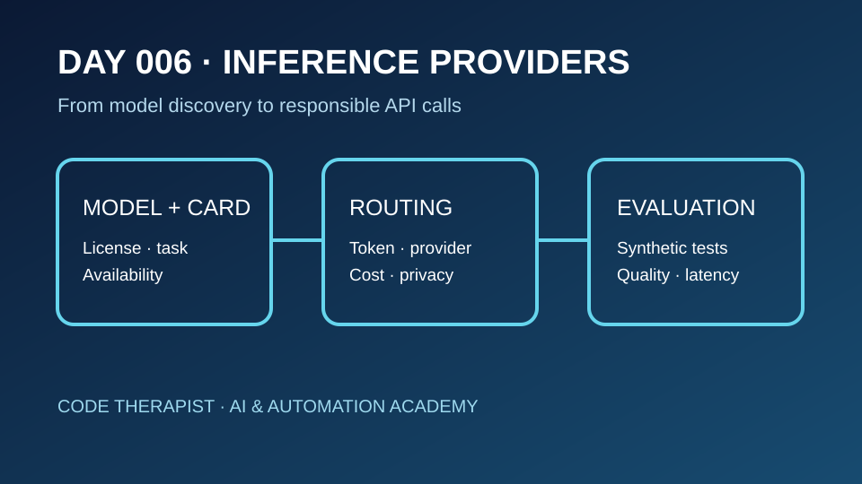
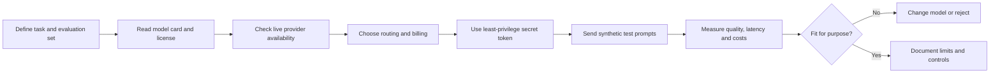

# Day 006 · Inference Providers: Choose, Route and Evaluate

**Department 03 — Platforms / Hugging Face** · **Season 01** · **12 November 2026** · **Status: published educational lesson; no paid inference executed**

[← Season index](./README.md) · [← Day 005](./DAY-005-MODEL-REPOSITORY-SECURITY.md)

## Learning outcomes

Explain the difference between a model repository and a hosted inference service; compare routing and billing approaches; plan safe API authentication; and evaluate model output with documented tests.

## Lecture

### 1. Model ≠ provider ≠ application

A **model repository** contains artifacts and documentation. An **inference provider** supplies computing infrastructure that runs a supported model. An **application** sends requests and uses responses. Hugging Face's Inference Providers integrate multiple providers through its Hub and SDKs. Not every repository is deployed by every provider; verify the model/provider combination at the time of use.

### 2. Discover the model before writing code

Begin with the task (chat, classification, embeddings, vision, etc.). Read the model card for publisher, license, supported inputs, limitations, and known evaluation. Check provider availability and access conditions. A polished demo does not prove the model is reliable on your specific data.

### 3. Routing, credentials and costs

Hugging Face documents both **Hugging Face-routed requests** (usage billed through Hugging Face) and **custom provider keys** (provider billing). The provider, model, account plan, usage and pricing can change. Consult the live pricing page before any paid experiment; do not assume free usage or fixed quotas.

Create a fine-grained token with only required inference permissions. Keep tokens in a secret manager or environment variable, never in browser source, a public GitHub commit, screenshots or student assignments. Limit spending, request volume and output length. Use test data without confidential personal information. Review the external provider's privacy policy separately.

### 4. Measure rather than repeat benchmark claims

Compare candidate systems on the **same** small, consented or synthetic task set. Record response quality, errors, latency, total token usage and observed cost. Separate vendor benchmark statements from your own reproducible measurements. If no experiment was run, write **not tested**.

## Architecture

## Guided practice — no payment or API key required

**Scenario:** a fictional bookshop wants an AI assistant to categorize customer questions.

1. Write five fictional example questions and expected categories.
2. Compare a text-classification model and a chat model; justify the task choice.
3. Find two model cards, identify license and limits, and check which providers *currently* offer inference.
4. Sketch a server-side request with `HF_TOKEN` in an environment variable; **do not include a real token**.
5. Build a table: model, provider, published price, expected cost assumptions, privacy considerations, and test status.
6. Define pass/fail criteria for accuracy, refusal on unsupported queries, latency and monthly spend.
7. Explain how you would handle a provider outage and a billing spike.

**Deliverable:** one-page decision memo and Mermaid flow diagram. **Execution status:** planning exercise only.

## Quiz (10 marks)

1. What is the difference between a model and an inference provider? (2)
2. Why might a model on the Hub not be callable through a chosen provider? (2)
3. Compare Hugging Face-routed billing and a custom provider key. (2)
4. Where should an API token be stored, and why? (2)
5. Name two observations you must measure yourself rather than accepting vendor claims. (2)

## Official references — reviewed 12 November 2026

- [Inference Providers documentation](https://huggingface.co/docs/inference-providers/index)
- [Pricing and billing](https://huggingface.co/docs/inference-providers/pricing)
- [Hub integration](https://huggingface.co/docs/inference-providers/hub-integration)
- [Security and privacy](https://huggingface.co/docs/inference-providers/security)
- [Hub access tokens](https://huggingface.co/docs/hub/security-tokens)

**Editorial status:** This is a new classroom lesson based on existing documentation, **not** a claim of a newly released model, newly changed price, independently tested benchmark or safety incident.
