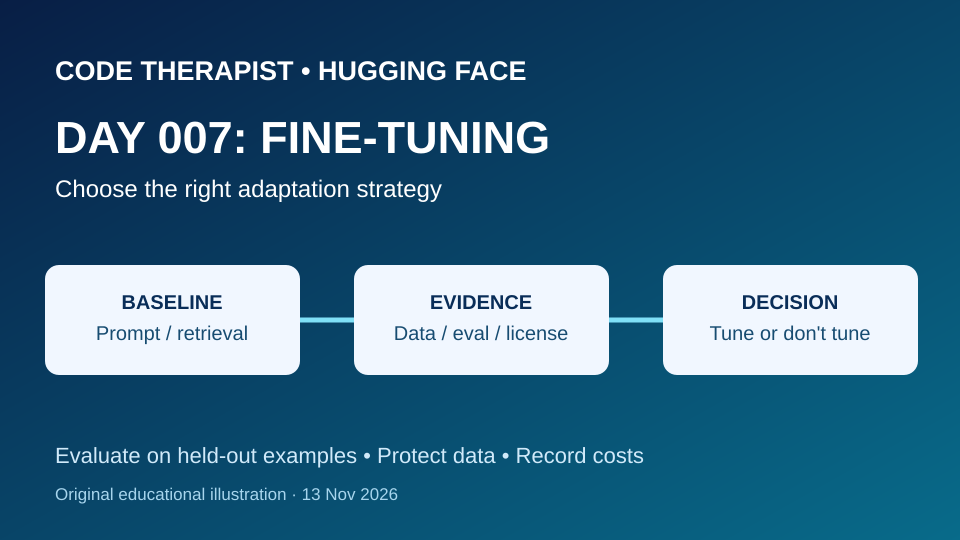
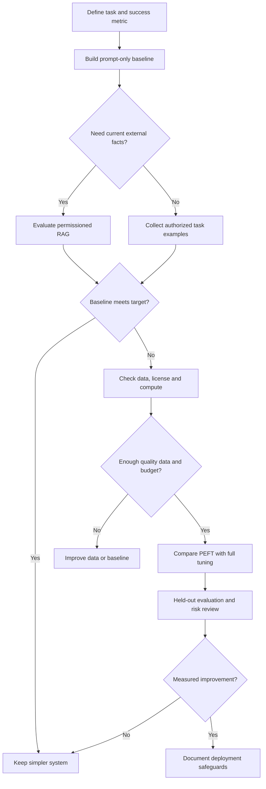

# Day 007 · Should You Fine-Tune a Model?

**Department 03 — Platforms / Hugging Face · Season 01 · 13 November 2026**  
**Status:** Published educational planning lesson; no model training, deployment or benchmark run.

[← Season index](./README.md) · [← Day 006](./DAY-006-INFERENCE-PROVIDERS.md)

## Learning outcomes

By the end, explain what fine-tuning changes; distinguish prompting, retrieval-augmented generation (RAG), full fine-tuning and parameter-efficient fine-tuning (PEFT); design a leakage-resistant evaluation plan; and justify a budget-conscious decision.

## Lecture

### 1 · First establish a baseline

Fine-tuning continues training a pretrained model on task-specific examples. It changes model parameters; prompting and RAG do not inherently change the model weights. For frequently changing factual knowledge, retrieval may be more maintainable than training. For stable classification or output-format behavior, a fine-tuned model *may* help, but it must outperform a measured baseline.

### 2 · Data quality comes before training

Write down the target task and success criteria. Use licensed, authorized data; remove personal identifiers; deduplicate near-identical samples; and split training, validation and held-out test examples by the right unit (for example, by customer or document rather than by sentence). Do not train on test answers. Document class imbalance, languages, and examples the model must decline.

### 3 · Pick an adaptation approach

- **Prompting:** fastest baseline; useful when a good instruction solves the task.
- **RAG:** retrieve current permitted facts and provide evidence in the prompt; retrieval quality and access control still require evaluation.
- **PEFT / LoRA:** train a small set of additional parameters rather than updating all weights; often reduces training resource needs, but results vary.
- **Full fine-tuning:** updates many or all parameters; can require substantially more memory and compute. A larger training budget does not guarantee better performance.

Read the checkpoint's license, architecture, tokenizer, trust requirements and memory needs before choosing a technique. Check Hugging Face's current Transformers and PEFT documentation for version-compatible APIs rather than copying stale snippets.

### 4 · Measure improvement and operational risk

Keep a frozen test set. Compare the same examples before and after adaptation, using task-appropriate metrics (for example macro-F1 for imbalanced classification), error analysis, inference latency, memory and total cost. Record random seeds, model revision, data version, hardware, package versions and evaluation protocol. Investigate regressions, privacy leakage and harmful outputs. If training was not run, write **not tested**.

## Decision workflow

## Guided practice · No GPU or paid account needed

**Fictional scenario:** a Ugandan bookshop receives customer messages about delivery, stock and returns.

1. Draft 12 fictional customer messages and three category labels; include two ambiguous cases.
2. Define a measurable baseline (for example macro-F1 on a separate held-out set) and an error-review sheet.
3. Compare three options: prompt-only classification, RAG for changing stock policy, and PEFT for stable classification behavior.
4. Specify how you would obtain 100 *authorized* examples, separate train/test sources and detect duplicates.
5. Estimate resources and list what must be checked before running training; do not fabricate accuracy or costs.
6. Write a one-page decision memo: recommended option, why, alternatives, risks and **not tested** status.

**Submission:** one-page decision memo, example dataset schema and Mermaid decision diagram.

## Quiz · 10 marks

1. What changes during fine-tuning that does not change during ordinary prompting? (2)
2. Why might RAG be better for changing inventory policies? (2)
3. Explain one difference between LoRA/PEFT and full fine-tuning. (2)
4. How can duplicate customers across train and test splits distort evaluation? (2)
5. Name two metrics or risks to compare against the baseline. (2)

## Official references · Checked 13 November 2026

- [Hugging Face Transformers — Fine-tuning](https://huggingface.co/docs/transformers/main/training)
- [Hugging Face PEFT documentation](https://huggingface.co/docs/peft/index)
- [Hugging Face Datasets](https://huggingface.co/docs/datasets/index)
- [Hugging Face Model Cards](https://huggingface.co/docs/hub/model-cards)

**Editorial note:** An educational lesson, not a newly released model or a claim of tested improvement. All illustrative data is fictional.
