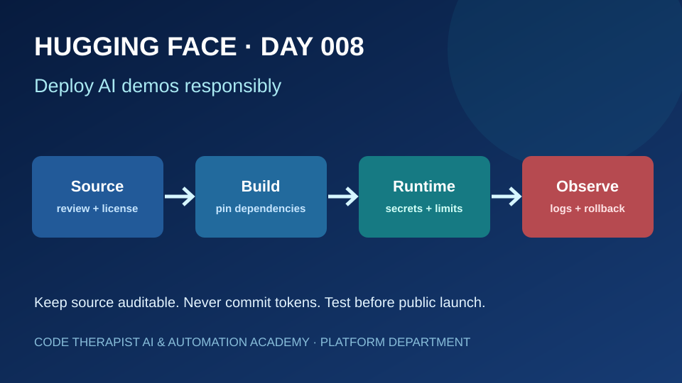
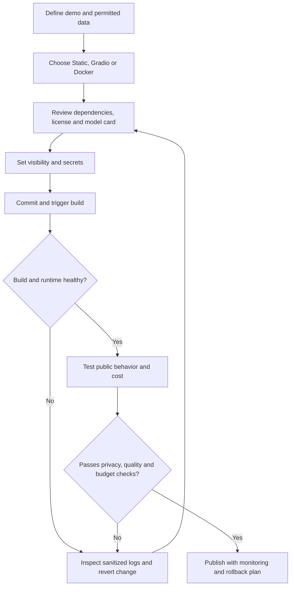

# Day 008 — Deploying and Operating Hugging Face Spaces Safely

**Department:** 03 — Platforms · **Platform:** Hugging Face · **Season:** 01 · **Day:** 008  
**Published:** 14 November 2026 · **Status:** Published educational lesson; no live deployment claimed  
[← Season index](./README.md) · [← Platform overview](../README.md)

## Learning outcomes

After this lesson, you should be able to distinguish a Space repository from its running application; choose a suitable SDK; identify deployment, privacy and cost risks; and plan a rollback without exposing credentials.

## Lecture — from a repository to a dependable demo

A **Space** is a hosted application linked to a versioned repository. Hugging Face supports **static HTML**, **Gradio**, and **Docker** Space types. A source commit can trigger a rebuild and restart; therefore, a successful Git commit is not evidence that an application is running or healthy. Check the build/runtime state and test the live app separately.

**1. Choose the simplest deployment.** Static HTML works for demonstrations that do not require server-side model execution. Gradio suits Python interactive ML demos. Docker provides more control but requires explicit dependency, networking and runtime maintenance. Do not select a GPU merely because the application mentions AI: first measure actual model memory, latency and throughput needs.

**2. Protect access.** Public Spaces expose source and the app. Protected Spaces hide source but expose the running app through an embed/custom-domain URL; private Spaces restrict both. Visibility is not a substitute for input validation or authorization. Use Space **Secrets** for tokens and sensitive configuration; never put them in a README, source file, example request, browser JavaScript or build logs.

**3. Plan the operating budget.** Hugging Face documentation currently distinguishes free static Spaces from Gradio/Docker compute Spaces that may require an eligible paid subscription or billing. The CPU Basic hardware itself has no hourly rate, but eligibility to create a compute Space is a separate question. GPU upgrades have additional rates. Pricing, quotas and terms can change; confirm them in the account and current official pricing page before launching.

**4. Plan for failure.** A demo needs a health check, reproducible dependencies, safe logging, timeout/error messages, abuse limits, cost alerts, a tested fallback, and a rollback plan. Treat ephemeral disk as non-durable. Never store learner records, passwords or production customer information in an experimental public Space.

**5. Separate provider claims from evidence.** A published demo, a green build indicator or a benchmark in a model card does not establish accuracy, privacy compliance or uptime. Record your own test date, test cases, hardware and limitations.

## Deployment and recovery workflow

## Guided practice — fictional Kampala bookshop demo (no deployment required)

1. Define a harmless demo that classifies **synthetic** book requests into three categories. Write five example inputs and expected outputs.
2. Choose **Static** for a precomputed interactive explainer, or **Gradio** if Python inference is required. Explain your choice.
3. Draft a repository plan with `README.md`, application entry point, pinned dependencies, license and a short model/dataset provenance note.
4. Prepare a table with columns: threat, prevention, detection, recovery. Include token leakage, unexpected billing, malicious dependency and failed build.
5. Specify a smoke test (expected HTTP/application behavior), one failure case, and a rollback to the last known working commit.
6. Estimate budget only after checking current official account eligibility and pricing; mark unverified costs **TBD**. Do not use real client data.

**Submission:** one-page deployment decision, threat table, five synthetic tests and a rollback checklist. **Status:** exercise only; no model training, deployment or benchmark was executed by this lesson.

## Knowledge check

1. Does a successful Git commit prove the Space app is running? **No** — verify build and runtime.
2. Is protected visibility the same as private? **No** — protected app access can remain public.
3. Where should API tokens be stored? **In Space Secrets**, not source or logs.
4. Does free CPU Basic hardware mean every account can create free Gradio Spaces? **No** — compute Space creation eligibility is distinct.
5. Why keep a rollback commit? **To restore a known-working state** after an unsafe or broken deployment.

## Primary sources and editorial notes

- [Hugging Face — Spaces overview](https://huggingface.co/docs/hub/spaces-overview) — SDKs, visibility, build behavior, hardware and access.
- [Hugging Face — Spaces configuration reference](https://huggingface.co/docs/hub/spaces-config-reference) — README YAML configuration.
- [Hugging Face — Manage your Space](https://huggingface.co/docs/huggingface_hub/guides/manage-spaces) — hardware, secrets and runtime management.
- [Hugging Face — GPU Spaces](https://huggingface.co/docs/hub/spaces-gpus) — compute details and costs.

**Source review date:** 14 November 2026. All figures and platform policies are provider documentation, not independently tested academy measurements. This is a platform lesson, **not** a model release.
